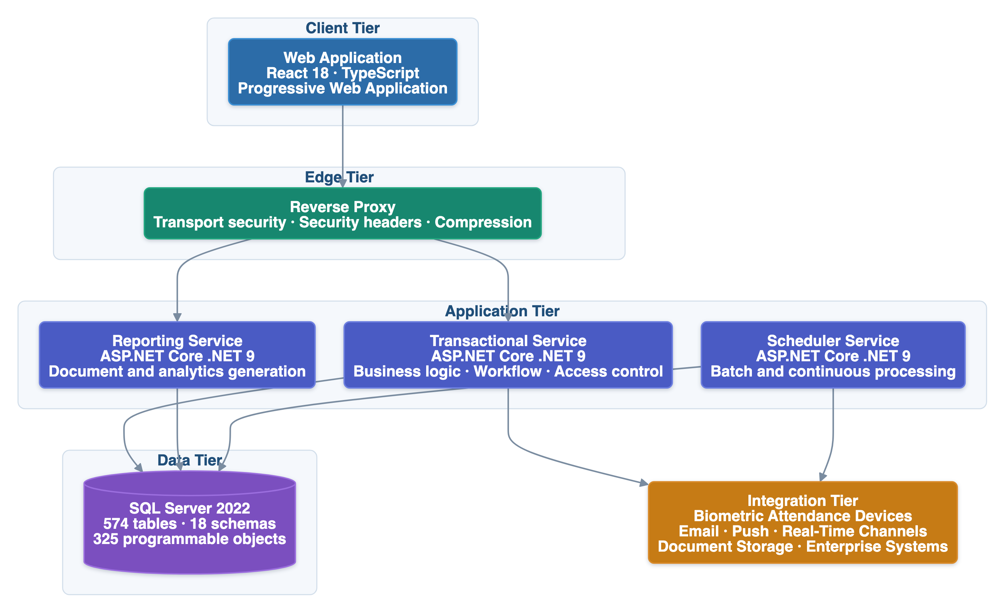
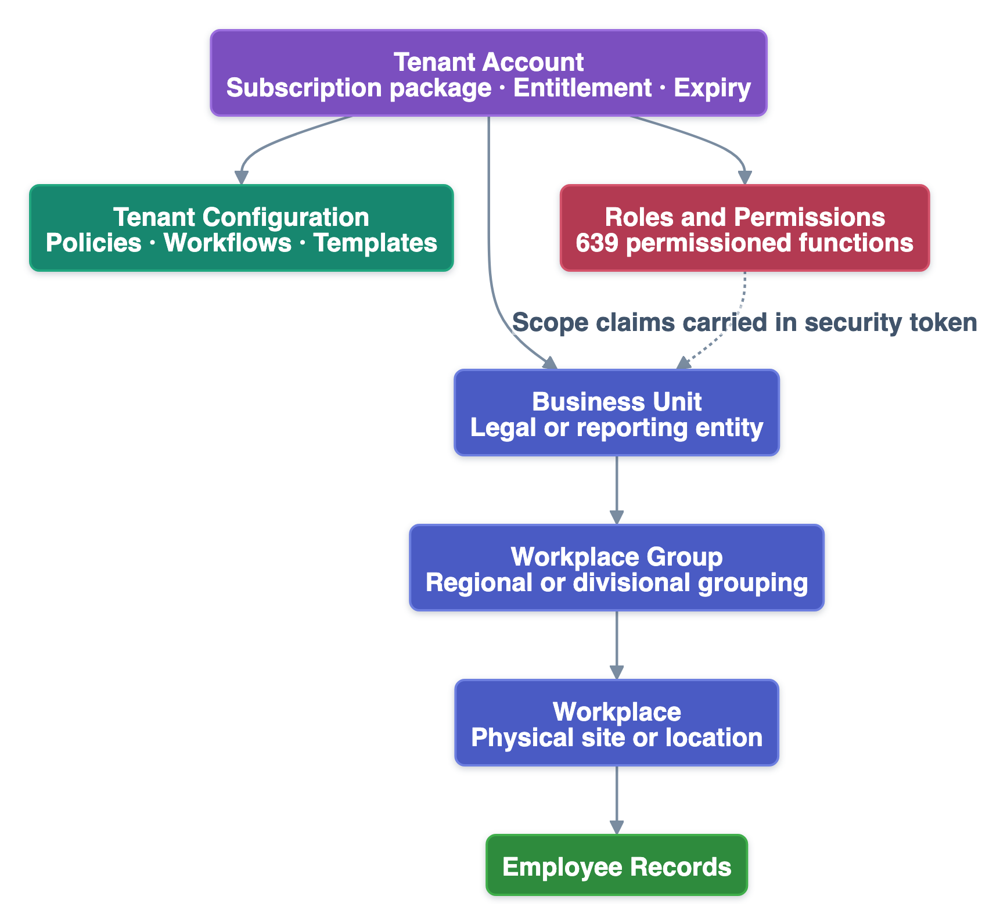
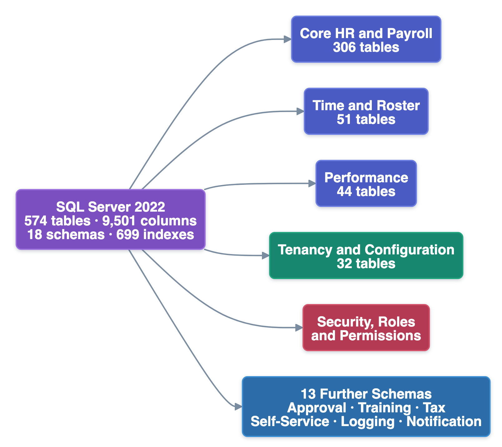
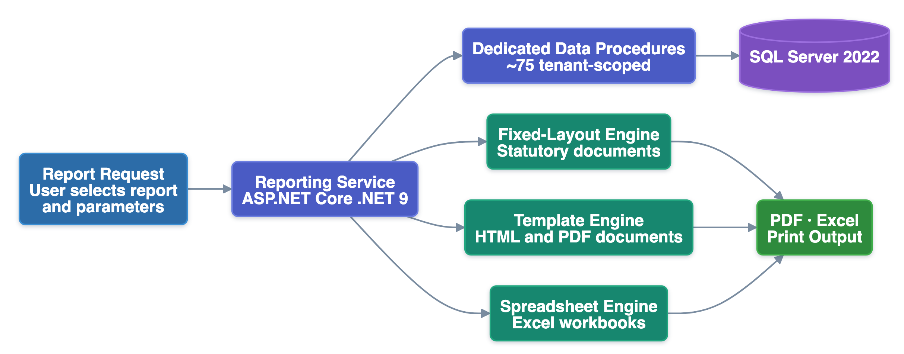
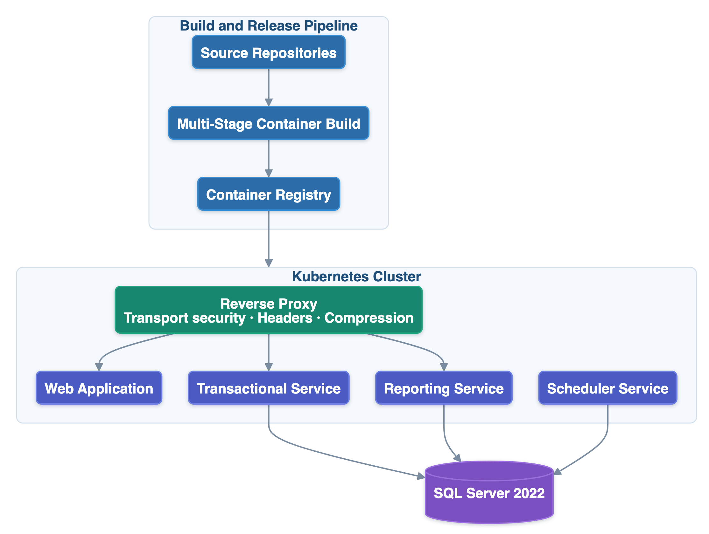

# PeopleDesk HRMS — Slide Source (Google Slides / PowerPoint)

**Classification:** Customer Confidential · **Version:** 2.1 · **Generated:** 01 June 2026 · **Last Updated:** 25 July 2026

> **What this file is.** The editable source of the 21-slide presentation deck. It mirrors
> `PeopleDesk-HRMS-Presentation-v2.1.pptx` slide for slide — same titles, subtitles, bullets, tables and diagrams.
>
> **How to use.** Each `---` marks a slide boundary. Import into Google Slides (File → Import) or a Markdown-to-slides tool, or edit here and rebuild the deck.
>
> **Diagrams** are embedded from `diagrams/` — the same rendered images used in the `.pptx`. Their Mermaid source lives in the master document, `PeopleDesk-HRMS-Technical-Architecture-v2.1.md`.
>
> **Figures are rounded for presentation.** Exact measured values are in the master document.

---

# PeopleDesk HRMS

**Enterprise SaaS Human Resource Management Platform**

Technical Architecture Overview

Prepared for Enterprise Architecture Review

Customer Confidential · Version 2.1 · 25 July 2026

---

# Why PeopleDesk HRMS 📋

*Six positions, each grounded in the production implementation*

| Position | Basis |
|---|---|
| **Enterprise Ready** | 19 business domains · 600+ permission controls · 40+ approval workflows |
| **SaaS Native** | Tenant-partitioned with a three-level organizational hierarchy |
| **Production Proven** | 120+ live customers at multi-million-row scale |
| **Cloud Deployable** | Containerized, orchestrated, configuration injected per environment |
| **Open and Integrable** | 1,500+ documented REST endpoints plus device connectivity |
| **Layered Security Controls** | Identity, authorization, transport, data and audit |

---

# Platform at a Glance 🧩

*Scale of the deployed platform*

| Dimension | Measure |
|---|---|
| **Business domains** | 19 |
| **REST endpoints** | 1,500+ |
| **Application screens** | 750+ |
| **Standard reports** | 130+ |
| **Data platform** | 570+ tables · 18 schemas |
| **Permission controls** | 600+ |
| **Automated processes** | 45+ |
| **Customers** | 120+ |

---

# Product Overview 🧩

*Nineteen functional domains on one platform and one permission model*

- **Core HR —** Employee Management, Organizational Framework, Configuration
- **Time & Attendance —** Attendance, Leave & Movement, Roster & Shift
- **Payroll & Benefits —** Payroll & Tax, Allowances, Loan, Benefits, Retirement
- **Talent —** Recruitment, Performance, Training, Manpower Analysis
- **Governance —** Approval Workflow, Asset, Expense, Employee Self-Service
- **Depth —** 600+ permission controls · 40+ configurable approval workflows

---

# Solution Architecture 🏗

*Four independently deployable services over a unified data platform — interactive, reporting and batch workloads physically separated*

---

# Architecture Principles 🏗

*Seven principles applied consistently across the platform*

| Principle | Application in PeopleDesk HRMS |
|---|---|
| **Separation of Concerns** | Workloads isolated by service boundary |
| **Stateless Services** | Token-based identity, no server-side session state |
| **Configuration over Customization** | Structure, roles and workflows configured per tenant |
| **Open API Surface** | Capability exposed through documented REST interfaces |
| **Layered Security** | Controls at identity, authorization, transport, data and audit |
| **Cloud Ready** | Containerized services with per-service orchestration manifests |
| **Evidence-Based Evolution** | Every change impact-analyzed against a knowledge model |

---

# Why This Architecture Matters 🏗

*Architectural decisions translated into business outcomes*

| Decision | Business Outcome |
|---|---|
| **Independent service deployment** | Faster feature delivery |
| **Workload-class separation** | Lower operational risk |
| **Stateless application tier** | Enterprise scalability |
| **Modular boundaries** | Easier maintenance |
| **Dedicated reporting tier** | Predictable performance |
| **Scheduler isolation** | High-availability foundation |
| **Configuration-led tenancy** | Lower onboarding cost |

---

# Quality Attributes ⚡

*Non-functional requirements and the design response*

| Quality Attribute | Design Response |
|---|---|
| **Scalability** | Stateless application services |
| **Availability** | Independently deployable services |
| **Security** | Layered security controls |
| **Maintainability** | Modular architecture |
| **Extensibility** | Service separation |
| **Performance** | Dedicated reporting service |
| **Reliability** | Background scheduler isolation |

---

# Technology Stack ⚙️

*Current-generation technology across every tier*

| Layer | Technology |
|---|---|
| **Frontend** | React 18 · TypeScript · Vite 7 · Redux Toolkit |
| **Backend** | ASP.NET Core .NET 9 · MediatR · FluentValidation |
| **Data Access** | EF Core 9 (writes) · Dapper (reads) · Stored procedures |
| **Database** | SQL Server 2022 |
| **Authentication** | JWT bearer · refresh-token rotation · scope claims |
| **Reporting** | RDLC · Handlebars + headless rendering · ClosedXML |
| **Background** | Quartz.NET · .NET Hosted Services |
| **Infrastructure** | Docker · Reverse proxy · Kubernetes |

*Selection criteria: modern · stable · long-term supported · enterprise proven · cloud compatible*

---

# Security Architecture 🔒

*Layered controls across five domains*

- **Authentication —** JWT bearer with issuer and signing-key validation; server-side refresh-token rotation; federated sign-in
- **Authorization —** 600+ permission controls; role-based assignment; organizational-scope claims in the security token
- **Application data —** payload protection, declarative validation, centralized exception handling, output sanitization
- **Transport & edge —** HTTPS enforcement, HSTS, frame protection, content-type enforcement, browser feature restriction
- **Audit —** request-level audit trail; background process execution history

---

# Secure Development Practices 🔒

*Security controls mapped to the OWASP Secure Coding Practices categories*

| OWASP Category | Implemented Controls |
|---|---|
| **Input Validation** | Server-side validation pipeline on every command |
| **Output Encoding** | Untrusted markup neutralized before rendering |
| **Session Management** | Token validation with server-side refresh-token rotation |
| **Access Control** | 600+ permissioned functions with organizational scope |
| **Error Handling & Logging** | Centralized handling; request-level audit trail |
| **Communication Security** | HTTPS with HSTS and the full edge header set |
| **Database Security** | Parameterized queries and stored-procedure access |
| **System Configuration** | Current supported versions; per-environment configuration |

---

# SaaS Architecture ☁️

*Tenant-partitioned with enterprise organizational depth*

- Every business record keyed to its owning tenant account
- Three-level hierarchy — business unit → workplace group → workplace
- Organizational scope carried in the security token
- Automated tenant provisioning with seed configuration
- Basic 100 · Lite 500 · Premium 50,000 seats
- Seat and expiry entitlements enforced automatically

---

# Data Architecture 🗄

*570+ tables · 18 schemas · 690+ indexes — engineered for set-based processing at scale*

---

# Reporting & Analytics 📊

*A separate reporting service — no contention with transactional workload*

- 130+ standard reports served by dedicated tenant-scoped data procedures
- Render engine selected by output class — statutory, document, spreadsheet
- Organization-specific templates without forking the report catalogue

---

# Deployment Architecture 🚀

*Containerized, orchestrated, independently releasable*

- One image promoted across environments; configuration injected per environment
- The artefact promoted to production is identical to the one validated in staging

---

# Scalability & Performance ⚡

*Scalability designed into the workload topology*

- Batch payroll isolated from interactive workload by service boundary
- Stateless authentication removes application-tier affinity constraint
- Set-based computation at the data tier rather than application iteration
- 690+ indexes across a 570+ table production schema
- Route-level code splitting with vendor chunk separation on the frontend
- **Production evidence —** core operational tables sustain 20–40 million+ rows

---

# Integration Ecosystem 🔌

*Open interfaces and proven enterprise connectivity*

- REST across 1,500+ endpoints with OpenAPI specification
- **Biometric attendance devices —** push-protocol capture plus 18+ scheduled collectors
- Real-time in-application notification channel
- Firebase Cloud Messaging push delivery
- SMTP email for notification and approval routing
- Azure Blob and FTP document storage · Managerium ERP integration

---

# Knowledge-Driven Engineering 🧭

*How the platform evolves safely over a multi-year dependency*

- A twelve-layer structured knowledge base is the authoritative model of the system
- 160+ documents · 30+ decision tables · complete inter-module dependency graph
- Every proposed change is impact-analyzed against the model before implementation
- The first two phases of this framework are in production use today
- Addresses what architecture alone cannot: predictable evolution over time

---

# Business Value ✅

*What the architecture delivers commercially*

| Benefit | Basis |
|---|---|
| **Reduced implementation risk** | Production-proven across 120+ enterprise customers |
| **Lower operational cost** | Configuration-led onboarding rather than code change |
| **Independent scaling** | Workload classes scale on separate boundaries |
| **Future-ready platform** | Current-generation runtimes, no end-of-life dependency |
| **Enterprise governance** | 600+ permission controls with organizational scope |
| **High maintainability** | Modular boundaries plus a structured knowledge model |

---

# Technical Position Summary ✅

*PeopleDesk HRMS at a glance*

| Dimension | Position |
|---|---|
| **Architecture** | Four services, workload-class separation, unified data platform |
| **Technology** | .NET 9 · React 18 · SQL Server 2022 — no end-of-life dependency |
| **Security** | Layered controls mapped to the OWASP Secure Coding Practices categories |
| **SaaS** | Tenant-partitioned, three-level organizational hierarchy |
| **Scale** | Production-validated at multi-million-row operational volume |
| **Integration** | Open REST plus proven enterprise and device connectivity |

---

# Thank You

PeopleDesk HRMS · Customer Confidential · Version 2.1 · 25 July 2026
