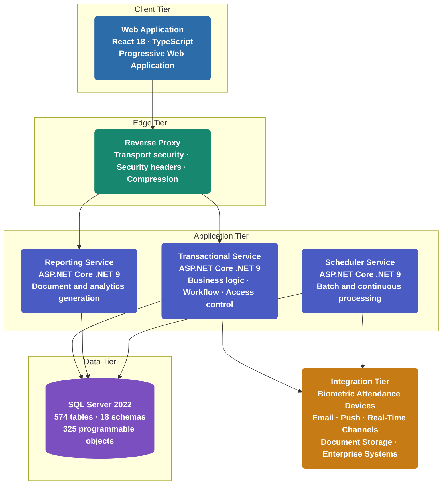
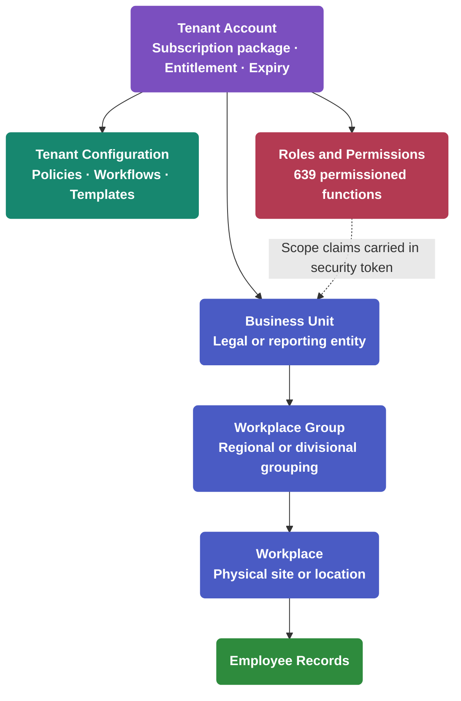
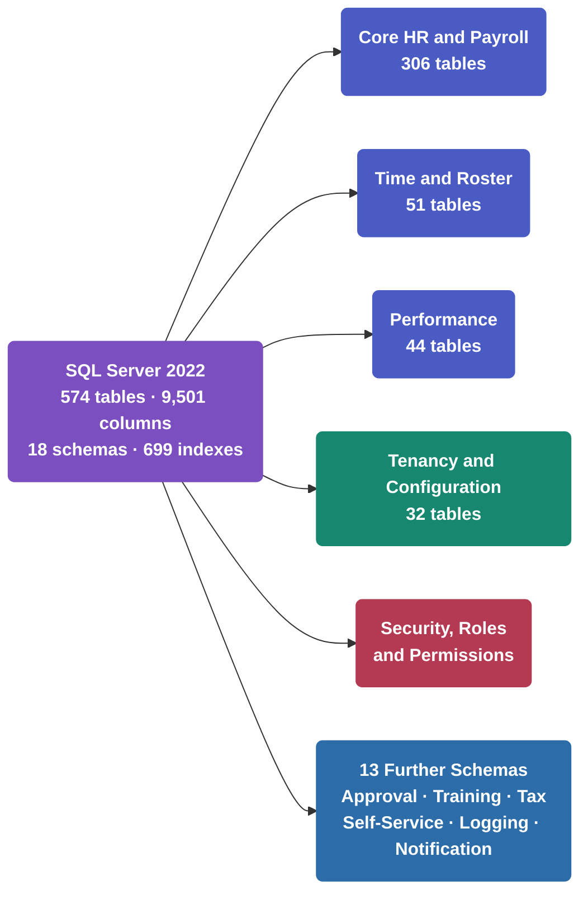
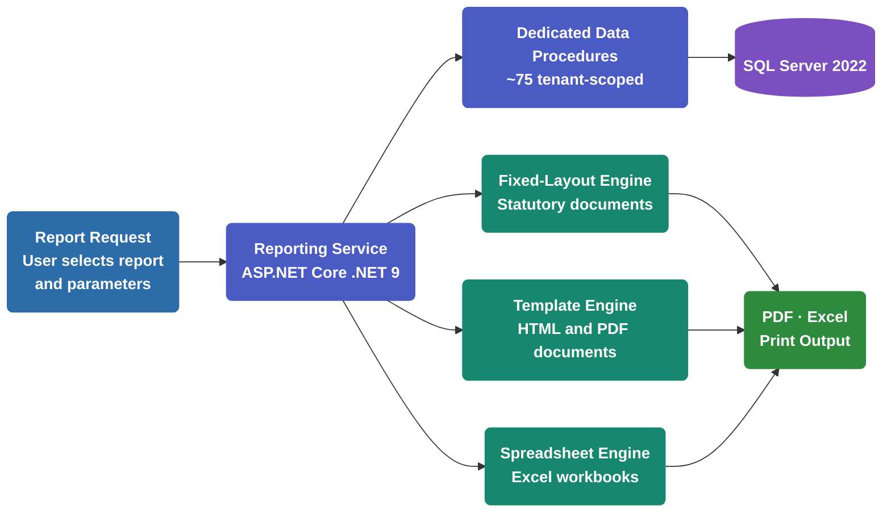
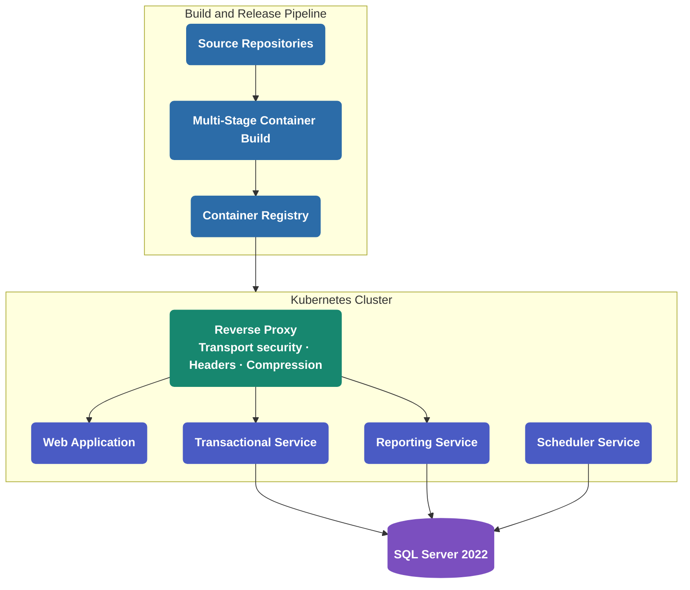

# PeopleDesk HRMS

### Enterprise SaaS Human Resource Management Platform

## Technical Architecture Overview

**Prepared for Executive Technology Leadership**

---

## Document Control

| Attribute | Value |
|---|---|
| **Document Title** | PeopleDesk HRMS — Technical Architecture Overview |
| **Document Classification** | Customer Confidential |
| **Document Status** | Released |
| **Version** | 2.1 |
| **Prepared By** | PeopleDesk Engineering Team |
| **Prepared For** | Enterprise Architecture Review |
| **Generated On** | 01 June 2026 |
| **Last Updated** | 25 July 2026 |
| **Document Owner** | Engineering Leadership |

### Revision History

| Version | Date | Author | Description |
|---|---|---|---|
| 1.0 | 01 June 2026 | Engineering | Initial Architecture Draft |
| 1.5 | 10 July 2026 | Engineering | Technical Review |
| 2.0 | 25 July 2026 | Engineering | Customer CTO Presentation Release |
| 2.1 | 25 July 2026 | Engineering | Final Release — business value, quality attributes, appendices |

### Scope & Basis

This document describes the technical architecture of the PeopleDesk HRMS platform as currently implemented and operating in production. It covers solution architecture, technology stack, security architecture, SaaS architecture, data architecture, reporting, deployment, scalability, and integration capability.

All capability statements reflect the deployed implementation. Forward-looking items are presented exclusively in the identified programme subsection (§10) and are not represented as current capability.

### Intended Audience

Chief Technology Officer · Chief Architect · Enterprise Architecture Review Board · Solution Evaluation Committee · Engineering Leadership

---

## Table of Contents

| | Section | Title | Focus |
|---|---|---|---|
| 📋 | **1** | [Executive Summary](#1-executive-summary-) | Platform position, highlights and scale |
| 🧩 | **2** | [Product Overview](#2-product-overview-) | Functional domains and capability metrics |
| 🏗 | **3** | [Solution Architecture](#3-solution-architecture-) | Topology, principles, quality attributes and business value |
| ⚙️ | **4** | [Technology Stack](#4-technology-stack-️) | Selection principles and platform technology matrix |
| 🔒 | **5** | [Security Architecture](#5-security-architecture-) | Implemented controls and secure development practices |
| ☁️ | **6** | [SaaS Architecture](#6-saas-architecture-️) | Tenancy, hierarchy and commercial model |
| 🗄 | **7** | [Data Architecture](#7-data-architecture-) | Data platform design and scale |
| 📊 | **8** | [Reporting & Analytics](#8-reporting--analytics-) | Reporting service and output capability |
| 🚀 | **9** | [Deployment Architecture](#9-deployment-architecture-) | Containerization, orchestration and release |
| ⚡ | **10** | [Scalability & Performance](#10-scalability--performance-) | Load characteristics and design decisions |
| 🔌 | **11** | [Integration Ecosystem](#11-integration-ecosystem-) | External and device connectivity |
| ✅ | **12** | [Summary and Business Value](#12-summary-and-business-value-) | Technical position and customer benefits |
| 📎 | **A** | [Appendix A — Platform Metrics Reference](#appendix-a--platform-metrics-reference) | Consolidated measured figures |
| 📖 | **B** | [Appendix B — Glossary and Acronyms](#appendix-b--glossary-and-acronyms) | Terminology reference |

---
---

## 1. Executive Summary 📋

> **Key Takeaways**
>
> ✔ Enterprise-grade, multi-tenant HRMS operating in production across 120+ live customers
>
> ✔ Four independently deployable services over a unified 574-table enterprise data platform
>
> ✔ Current-generation technology throughout — .NET 9, React 18, SQL Server 2022
>
> ✔ Production-proven at 20–41 million rows per core operational table
>
> ✔ Nineteen functional domains covering the complete employee lifecycle

### Why PeopleDesk HRMS

| | Position | Basis |
|---|---|---|
| ✔ | **Enterprise Ready** | 19 functional domains · 639 permissioned functions · 40+ configurable approval workflows |
| ✔ | **SaaS Native** | Tenant-partitioned data model with a three-level organizational hierarchy |
| ✔ | **Production Proven** | 120+ live customers sustaining 20–41 million rows per core table |
| ✔ | **Cloud Deployable** | Containerized services, orchestration manifests, environment-injected configuration |
| ✔ | **Open and Integrable** | 1,525 documented REST endpoints plus proven enterprise and device connectivity |
| ✔ | **Layered Security Controls** | Identity, authorization, transport, application data and audit |

### Platform Position

PeopleDesk HRMS is a full-lifecycle Human Resource Management platform delivered as multi-tenant Software as a Service. It supports the complete employee journey — from recruitment and onboarding through attendance, payroll, performance and retirement — for large and mid-market enterprises with complex organizational structures, shift-based workforces, statutory payroll obligations and geographically distributed operations.

### Platform Scale

| Dimension | Measure |
|---|---|
| Business domains | 19 functional modules |
| Application programming interface | 1,525 endpoints |
| Application screens | 781 routes across 26 frontend modules |
| Standard reports | ~130, served by ~75 dedicated data procedures |
| Data platform | 574 tables · 9,501 columns · 18 schemas |
| Programmable database objects | 325 |
| Permission-controlled functions | 639 |
| Automated background processes | 46 |
| Customers in production | 120+ |

### Operating Characteristics

Core transactional tables sustain between 20 and 41 million rows in production. The platform separates interactive, reporting and batch workloads into distinct services so that high-volume processing — such as a monthly payroll run across tens of thousands of employees — cannot degrade interactive user response.

---

## 2. Product Overview 🧩

> **Key Takeaways**
>
> ✔ Nineteen functional domains unified on one data platform and one permission model
>
> ✔ 40+ configurable approval workflows spanning the operational estate
>
> ✔ 639 individually permissioned functions with discrete access rights
>
> ✔ Complete employee lifecycle coverage from recruitment to retirement

### Functional Domains

| Domain Group | Modules |
|---|---|
| **Core HR** | Employee Management · Organizational Framework · Master & Configuration |
| **Time & Attendance** | Attendance & Timesheet · Leave & Movement · Roster & Shift Management |
| **Payroll & Benefits** | Payroll & Tax · Allowance & Deduction · Loan · Benefits · Retirement (Provident Fund & Gratuity) |
| **Talent Management** | Recruitment & Onboarding · Performance Management · Training & Development · Manpower Analysis |
| **Operations & Governance** | Approval Workflow · Asset Management · Expense · Employee Self-Service |

### Capability Metrics

| Measure | Value |
|---|---|
| Application screens and frontend modules | 781 routes · 26 modules |
| Application programming interface endpoints | 1,525 |
| Standard reports | ~130 |
| Configurable approval request types | 40+ |
| Permission-controlled functions | 639 menu nodes |
| Automated scheduled and continuous processes | 46 |

### Governance Depth

Access governance is expressed through 639 individually permissioned functions, each carrying discrete view, create, edit and close rights. Operational governance is expressed through more than forty configurable approval workflow types spanning leave, movement, payroll, asset, expense and employee lifecycle events.

---

## 3. Solution Architecture 🏗

> **Key Takeaways**
>
> ✔ Four independently deployable services, each released on its own cadence
>
> ✔ Interactive, reporting and batch workloads physically separated by service
>
> ✔ Layered backend across 24 projects with explicit architectural boundaries
>
> ✔ Stateless request handling with no server-side session affinity

### System Topology

### Service Responsibilities

| Service | Responsibility |
|---|---|
| **Web Application** | Single-page application providing the complete user interface across 781 screens, delivered as an installable progressive web application |
| **Transactional Service** | Business logic, workflow orchestration, access control and transactional data operations across 1,525 endpoints |
| **Reporting Service** | Document and analytics generation across ~130 standard reports, isolated from transactional workload |
| **Scheduler Service** | Batch payroll and attendance processing, leave accrual, attendance device collection, and notification dispatch across 46 automated processes |

### Architecture Principles

| Principle | Application in PeopleDesk HRMS |
|---|---|
| **Separation of Concerns** | Interactive, reporting and batch workloads isolated by service boundary |
| **Stateless Services** | Token-based identity with no server-side session state |
| **Configuration over Customization** | Organizational structure, roles, workflows, policies and document templates configured per tenant |
| **Open API Surface** | Platform capability exposed through documented REST interfaces |
| **Layered Security** | Controls applied across identity, authorization, transport, application data and audit |
| **Cloud Ready** | Containerized services with per-service orchestration manifests |
| **Evidence-Based Evolution** | Every change impact-analyzed against a structured knowledge model before implementation |

### Quality Attributes and Design Response

| Quality Attribute | Design Response | Realized By |
|---|---|---|
| **Scalability** | Stateless application services | Token-based identity; no session affinity in the application tier |
| **Availability** | Independently deployable services | A reporting or batch failure does not affect interactive availability |
| **Security** | Layered security controls | Identity, authorization, transport, application data and audit controls |
| **Maintainability** | Modular architecture | 24 projects with explicit boundaries; change contained within a boundary |
| **Extensibility** | Service separation | New capability added to one service without redeploying the others |
| **Performance** | Dedicated reporting service | Document generation never contends with transactional workload |
| **Reliability** | Background scheduler isolation | Batch payroll executes outside the interactive request path |
| **Portability** | Container-based delivery | One image promoted across environments with injected configuration |

### Why This Architecture Matters

| Architectural Decision | Business Outcome |
|---|---|
| Independent service deployment | **Faster feature delivery** — a reporting change ships without touching the transactional service |
| Workload-class separation | **Lower operational risk** — month-end payroll processing cannot degrade the user experience |
| Stateless application tier | **Enterprise scalability** — capacity is added without session affinity constraints |
| Modular backend boundaries | **Easier maintenance** — the blast radius of a change is bounded and known in advance |
| Dedicated reporting tier | **Predictable performance** — heavy report generation is absorbed outside the transactional path |
| Scheduler isolation | **High-availability foundation** — a batch failure does not remove interactive service |
| Layered security controls | **Better security isolation** — no single control is the sole barrier |
| Configuration-led tenancy | **Lower onboarding cost** — a new organization is configured, not coded |

### Engineering Governance — Knowledge-Driven Development

The platform is developed under a formalized engineering framework in which a twelve-layer structured knowledge base — comprising 162 documents, 32 decision tables and a complete inter-module dependency graph — serves as the authoritative model of the system. Every proposed change is impact-analyzed against that model before implementation proceeds.

The first two phases of this framework are in production use. For an enterprise evaluating a multi-year platform dependency, this addresses a question that architecture alone cannot: whether the engineering organization can evolve the system safely and predictably over time.
---

## 4. Technology Stack ⚙️

> **Key Takeaways**
>
> ✔ Current-generation, long-term-supported technology across every tier
>
> ✔ Deliberate dual data-access strategy: ORM for transactional integrity, direct SQL for read throughput
>
> ✔ Fully containerized and orchestrated on industry-standard infrastructure
>
> ✔ No end-of-life runtime dependency at the platform level

### Technology Selection Principles

Platform technology is selected against five criteria, applied consistently across every tier:

| Criterion | Meaning |
|---|---|
| **Modern** | Current-generation frameworks and runtimes, not legacy branches |
| **Stable** | Mature release lines with predictable behaviour under production load |
| **Long-Term Supported** | Vendor-supported versions with a defined support horizon |
| **Enterprise Proven** | Widely deployed in comparable enterprise environments |
| **Cloud Compatible** | Runs unmodified in containerized and orchestrated environments |

### Platform Technology Matrix

| Layer | Technology |
|---|---|
| **Frontend** | React 18 · TypeScript · Vite 7 · Redux Toolkit · Ant Design · Material UI · Formik with Yup validation · Progressive Web Application |
| **Backend** | ASP.NET Core (.NET 9) · MediatR (CQRS) · FluentValidation · Mapster · SignalR · REST |
| **Data Access** | Entity Framework Core 9 for transactional operations · Dapper for high-volume read paths · SQL stored procedures for set-based computation |
| **Database** | Microsoft SQL Server 2022 |
| **Authentication** | JSON Web Token bearer authentication · server-side refresh-token rotation · organizational-scope claims · federated sign-in |
| **Reporting** | RDLC (fixed-layout statutory documents) · Handlebars with headless browser rendering (HTML and PDF) · ClosedXML (Excel) |
| **Background Processing** | Quartz.NET scheduled jobs · .NET Hosted Services for continuous processing |
| **Infrastructure** | Docker multi-stage builds · Reverse proxy · Kubernetes orchestration · Container registry distribution |
| **Build & Release** | Azure DevOps pipelines · containerized build and publish · environment-scoped configuration injection |
| **Development Tooling** | Git multi-repository workspace · Roslyn static analyzers · documented engineering playbooks · structured knowledge platform |

### Data Access Strategy

The platform applies a deliberate dual strategy rather than a single access pattern:

| Path | Technology | Rationale |
|---|---|---|
| Transactional writes | Entity Framework Core 9 | Change tracking, audit-column preservation and referential correctness on state-changing operations |
| High-volume reads | Dapper | Minimal object-mapping overhead on list, search and reporting paths |
| Bulk computation | SQL stored procedures | Payroll, attendance and accrual logic executed as set-based operations at the data tier |

---

## 5. Security Architecture 🔒

> **Key Takeaways**
>
> ✔ Layered security controls across identity, authorization, transport, application data and audit
>
> ✔ 639 individually permissioned functions with organizational-scope enforcement
>
> ✔ Complete request-level audit trail across all authenticated operations
>
> ✔ Controls mapped to the OWASP Secure Coding Practices categories

### 5.1 Authentication Controls

| Control | Implementation |
|---|---|
| Token-based authentication | JSON Web Token bearer authentication with issuer validation, signing-key validation and zero clock-skew tolerance |
| Session continuity | Server-side refresh-token issuance and rotation, with token history persisted to support revocation and traceability |
| Federated identity | Google OAuth sign-in support |

### 5.2 Authorization Controls

| Control | Implementation |
|---|---|
| Granular permission model | 639 individually permissioned functions, each carrying discrete view, create, edit and close rights |
| Role-based assignment | Per-tenant role definitions with permission sets assigned by role |
| Organizational scope | Business unit, workplace group and workplace scope carried within the security token and applied to data access |

### 5.3 Application Data Protection

| Control | Implementation |
|---|---|
| Application-layer data protection | Request and response payload protection applied between client and service in production environments |
| Declarative request validation | Validation pipeline evaluates every command against its declared rule set before business logic executes |
| Centralized exception handling | Structured problem-detail responses; internal failure detail is not returned to clients |
| Output sanitization | Untrusted markup neutralized across the application interface prior to rendering |

### 5.4 Transport & Edge Controls

| Control | Implementation |
|---|---|
| Transport security | HTTPS enforcement with HTTP Strict Transport Security — one-year maximum age, subdomain inclusion, preload |
| Frame protection | `X-Frame-Options: DENY` |
| Content type enforcement | `X-Content-Type-Options: nosniff` |
| Referrer control | `Referrer-Policy` restricted to same origin |
| Browser feature restriction | `Permissions-Policy` disabling geolocation, camera, microphone, payment and related device interfaces |
| Cross-domain policy | `X-Permitted-Cross-Domain-Policies` restricted |

### 5.5 Audit & Traceability Controls

| Control | Implementation |
|---|---|
| Request audit trail | Acting user, route and timestamp recorded for every authenticated operation |
| Process execution history | Separate success and failure records maintained for every automated background process |

### 5.6 Secure Development Practices

The platform's security controls are mapped to the **OWASP Secure Coding Practices** categories — the industry reference checklist for application-layer security. The table below shows the categories in which controls are implemented in the platform today, and where each is described in this document.

| OWASP Category | Implemented Controls | Reference |
|---|---|---|
| **Input Validation** | Server-side validation pipeline evaluates every command against its declared rule set before business logic executes | §5.3 |
| **Output Encoding** | Untrusted markup neutralized across the application interface prior to rendering | §5.3 |
| **Session Management** | Token-based sessions with issuer and signing-key validation, zero clock-skew tolerance, and server-side refresh-token rotation with persisted history | §5.1 |
| **Access Control** | 639 individually permissioned functions with role-based assignment and organizational-scope claims carried in the security token | §5.2 |
| **Error Handling and Logging** | Centralized exception handling with structured problem-detail responses; request-level audit trail and background process execution history | §5.3, §5.5 |
| **Communication Security** | HTTPS enforcement with HTTP Strict Transport Security, plus the full edge security header set | §5.4 |
| **Database Security** | Parameterized queries and stored-procedure–based data access across the platform's 235 stored procedures | §7 |
| **System Configuration** | Current supported framework versions throughout; configuration injected per environment with separated development, staging and production | §4, §9 |

---

## 6. SaaS Architecture ☁️

> **Key Takeaways**
>
> ✔ Tenant-partitioned data model applied across the entire data platform
>
> ✔ Three-level organizational hierarchy suited to multi-entity, multi-site enterprises
>
> ✔ Automated tenant provisioning and subscription entitlement enforcement
>
> ✔ Roles, workflows, policies and document templates configured per organization

### Tenancy & Organizational Model

### SaaS Capability Matrix

| Capability | Implementation |
|---|---|
| **Tenant partitioning** | Every business record is keyed to its owning tenant account across the data platform |
| **Organizational hierarchy** | Three-level structure — business unit, workplace group, workplace — with scope enforced through security-token claims |
| **Tenant provisioning** | Automated account creation flow establishing the organization, seed configuration and initial administrator |
| **Commercial packaging** | Three subscription tiers with seat, user and storage entitlements |
| **Entitlement enforcement** | Seat limits validated at employee creation; subscription expiry enforced automatically by a daily scheduled process |
| **Per-tenant configuration** | Roles, permissions, approval workflows, leave and payroll policies, and document templates configured independently per organization |

### Subscription Tiers

| Tier | Employee Entitlement | User Entitlement | Storage Entitlement |
|---|---|---|---|
| Basic | 100 | 100 | 1 unit |
| Lite | 500 | 500 | 50 units |
| Premium | 50,000 | 50,000 | 200 units |

### Enterprise Relevance

The three-level organizational hierarchy addresses enterprises operating multiple legal entities, regional divisions or physical sites under one corporate structure. Organizational scope is carried in the security token, so a divisional administrator's visibility is constrained by configuration rather than by bespoke query logic.

---

## 7. Data Architecture 🗄

> **Key Takeaways**
>
> ✔ Domain-partitioned enterprise data platform across 18 schemas
>
> ✔ Set-based computation executed at the data tier for payroll and attendance at scale
>
> ✔ 699 indexes maintained across a 574-table schema
>
> ✔ Production-proven at 20–41 million rows per core operational table

### Schema Organization

### Data Platform Characteristics

| Aspect | Approach |
|---|---|
| **Schema organization** | Domain-aligned schema separation — security, tenancy, time, performance, approval, tax and logging occupy distinct namespaces rather than a single flat catalogue |
| **Computation strategy** | 325 programmable objects — 235 stored procedures, 25 table-valued functions, 52 scalar functions and 6 views — execute payroll, attendance and accrual logic as set-based operations at the data tier |
| **Access strategy** | Entity Framework Core for transactional writes with change tracking and audit-column preservation; Dapper for high-volume read and reporting paths |
| **Index strategy** | 699 indexes maintained across the platform |
| **Read efficiency** | Cursor-based pagination, no-tracking reads and projection to data transfer objects in the current-generation data access layer |

### Production Data Volumes

Core operational tables sustain between 20 and 41 million rows in production; the full volume profile is presented in **Section 10 — Scalability & Performance**.

Executing payroll computation as set-based operations at the data tier — rather than through application-tier iteration — is the primary reason the platform sustains these volumes within operational processing windows.

---

## 8. Reporting & Analytics 📊

> **Key Takeaways**
>
> ✔ Physically separate reporting service — document generation never contends with transactional workload
>
> ✔ ~130 standard reports spanning payroll, statutory, attendance and workforce domains
>
> ✔ Render engine selected by output class for fidelity and performance
>
> ✔ Organization-specific document templates without forking the report catalogue

### Report Generation Flow

### Report Coverage

| Domain | Reports |
|---|---|
| **Payroll & Statutory** | Payslips · salary sheets · bank advice files · bonus and arrear statements · tax certificates · provident fund and gratuity statements · final settlement |
| **Attendance & Time** | Attendance registers · overtime · roster · movement · leave balance and history |
| **Workforce & Performance** | Manpower analysis · workforce planning · performance appraisal |
| **Operations** | Asset · cafeteria and food allowance · letters including increment, promotion and confirmation · identity cards |

### Rendering Strategy

| Output Class | Engine | Rationale |
|---|---|---|
| Statutory fixed-layout documents | RDLC | Pixel-exact layout fidelity required for regulatory submission |
| Designed HTML and PDF documents | Handlebars with headless browser rendering | Template-driven documents supporting organization-specific design |
| Analytical exports | ClosedXML | Native Excel workbook generation for downstream analysis |

### Organization-Specific Documents

Customer-specific payslip and salary-sheet templates are supported as data-driven documents within the reporting service. Adding an organization's document format does not require modification to the report catalogue or the rendering engines.

---

## 9. Deployment Architecture 🚀

> **Key Takeaways**
>
> ✔ Fully containerized with multi-stage builds across all services
>
> ✔ Kubernetes-orchestrated with per-service deployment manifests
>
> ✔ One image promoted across environments; configuration injected per environment
>
> ✔ Independent release cadence — a reporting change requires no transactional downtime

### Deployment Topology

### Deployment Characteristics

| Aspect | Implementation |
|---|---|
| **Containerization** | Multi-stage container builds per service, with build and runtime layers separated; runtime images carry only published output and required native dependencies |
| **Orchestration** | Kubernetes deployment and service manifests per service, with registry-based image distribution |
| **Edge layer** | Reverse proxy terminating traffic, serving the application shell, applying the security header set and compressing responses |
| **Configuration management** | Configuration injected through environment variables per environment; one image serves development, staging and production, differing only by injected configuration |
| **Release model** | Each service builds, versions and deploys independently; a reporting release requires no transactional service downtime |
| **Environments** | Separate development, staging and production environments with environment-scoped behaviour |

### Configuration Integrity

Because configuration is injected rather than embedded, the artefact promoted to production is bit-identical to the artefact validated in staging. This removes build-variance as a class of production defect.

> *The deployment topology shown represents the recommended enterprise production architecture. Actual deployment may vary according to customer infrastructure, cloud provider, security policies, and operational requirements.*

---

## 10. Scalability & Performance ⚡

> **Key Takeaways**
>
> ✔ Scalability designed into workload topology, not retrofitted through infrastructure
>
> ✔ Batch payroll processing isolated from interactive workload by service boundary
>
> ✔ Stateless authentication removes affinity constraint from the application tier
>
> ✔ Production-validated at 20–41 million rows per core table

### Design Decisions Supporting Scale

| Design Decision | Scalability Effect |
|---|---|
| **Workload-class separation** | Interactive, reporting and batch processing execute in separate services; batch payroll across tens of thousands of employees does not block interactive users |
| **Stateless authentication** | Token-based identity carries no server-side session state, removing affinity constraints from the application tier |
| **Set-based computation** | Payroll, attendance and leave accrual execute as data-tier set operations rather than application-tier iteration |
| **Efficient read path** | Cursor-based pagination, no-tracking queries and projection to data transfer objects avoid loading entity graphs for read operations |
| **Indexed data platform** | 699 indexes maintained against a 574-table schema operating at production volume |
| **Frontend delivery optimization** | Route-level code splitting across 649 lazy-loaded boundaries, vendor chunk separation, progressive web application asset precaching, and edge compression |

### Production Load Evidence

| Data Class | Rows Sustained |
|---|---|
| Background process execution history | 41.4 million |
| Raw attendance device capture | 27.5 million |
| Request audit trail | 21.4 million |
| Employee attendance records | 20.0 million |
| Payroll generation detail | 6.4 million |

### Scale-Out Programme

The following workstreams extend the platform's scale-out capacity:

- Distributed caching tier
- Horizontal auto-scaling of the application tier
- Read-replica offload for reporting workload
- Distributed coordination for batch processing

---

## 11. Integration Ecosystem 🔌

> **Key Takeaways**
>
> ✔ Open, standards-based REST interface across 1,525 endpoints
>
> ✔ Proven biometric attendance-device integration across 18+ customer environments
>
> ✔ Real-time, push and email notification channels operating in production
>
> ✔ Enterprise system integration demonstrated with external ERP

### Implemented Integration Capability

| Category | Capability |
|---|---|
| **Programmatic access** | REST interfaces across 1,525 endpoints, secured by token-based authentication and documented through OpenAPI specification |
| **Federated identity** | Google OAuth sign-in |
| **Biometric attendance devices** | Device-initiated capture through an industry-standard push protocol endpoint, complemented by 18+ dedicated collectors retrieving punch data from customer attendance servers on schedule |
| **Real-time notification** | Persistent notification channel delivering live in-application events |
| **Mobile and push notification** | Firebase Cloud Messaging delivery |
| **Electronic mail** | SMTP delivery for notifications, approval routing and system correspondence |
| **Document storage** | Azure Blob Storage and FTP-based document repositories |
| **Enterprise systems** | Managerium ERP integration for user and payroll data exchange |
| **Output and hardware** | Excel and PDF export across the platform; QR code generation with label-printer agent for asset tagging |

### Integration Maturity

Biometric attendance-device connectivity is among the more demanding integration classes in enterprise HRMS deployment, requiring both device-initiated and scheduled-retrieval patterns across heterogeneous customer device estates and network topologies. This capability is operating across 18+ customer environments in production.

---

## 12. Summary and Business Value ✅

### Technical Position Summary

| Dimension | Position |
|---|---|
| **Architecture** | Four independently deployable services with workload-class separation over a unified enterprise data platform |
| **Technology** | Current-generation .NET 9, React 18 and SQL Server 2022 with no end-of-life runtime dependency |
| **Security** | Layered controls across identity, authorization, transport, application data and audit, mapped to the OWASP Secure Coding Practices categories |
| **SaaS** | Tenant-partitioned with a three-level organizational hierarchy and commercial packaging model |
| **Scale** | Production-validated at 20–41 million rows per core operational table |
| **Integration** | Open REST interfaces with proven enterprise system and biometric device connectivity |

### Business Benefits

| Benefit | Basis in the Platform |
|---|---|
| **Reduced implementation risk** | Production-proven across 120+ enterprise customers spanning multiple sectors |
| **Lower operational cost** | Organizational structure, roles, workflows, policies and templates are configured rather than coded |
| **Independent scaling** | Interactive, reporting and batch workloads scale on separate service boundaries |
| **Future-ready platform** | Current-generation runtimes across every tier with no end-of-life dependency |
| **Enterprise governance** | 639 permissioned functions with organizational scope and a complete request-level audit trail |
| **High maintainability** | Modular service boundaries reinforced by a structured knowledge model governing every change |

---

## Appendix A — Platform Metrics Reference

All figures are measured against the current production implementation.

| Category | Metric | Value |
|---|---|---|
| **Functional** | Business domains | 19 |
| | Configurable approval request types | 40+ |
| | Permission-controlled functions | 639 |
| **Application** | REST endpoints | 1,525 |
| | Frontend routes | 781 |
| | Frontend modules | 26 |
| | Lazy-loaded route boundaries | 649 |
| **Data** | Tables | 574 |
| | Columns | 9,501 |
| | Schemas | 18 |
| | Indexes | 699 |
| | Programmable objects | 325 |
| | — Stored procedures | 235 |
| | — Table-valued functions | 25 |
| | — Scalar functions | 52 |
| | — Views | 6 |
| **Reporting** | Standard reports | ~130 |
| | Dedicated data procedures | ~75 |
| **Processing** | Automated background processes | 46 |
| **Deployment** | Independently deployable services | 4 |
| | Backend projects | 24 |
| **Production Volume** | Largest operational table | 41.4 million rows |
| | Core operational table range | 20–41 million rows |
| **Adoption** | Customers in production | 120+ |
| **Engineering** | Structured knowledge documents | 162 |
| | Decision tables | 32 |

---

## Appendix B — Glossary and Acronyms

| Term | Expansion | Meaning in This Document |
|---|---|---|
| **API** | Application Programming Interface | Programmatic interface exposing platform capability |
| **CQRS** | Command Query Responsibility Segregation | Pattern separating state-changing operations from read operations |
| **DI** | Dependency Injection | Composition technique supplying dependencies to a component at construction |
| **ERP** | Enterprise Resource Planning | External business system integrated with the platform |
| **HRMS** | Human Resource Management System | The platform category |
| **HSTS** | HTTP Strict Transport Security | Browser policy enforcing encrypted transport |
| **JWT** | JSON Web Token | Signed token carrying identity and organizational-scope claims |
| **OAuth** | Open Authorization | Delegated authorization standard used for federated sign-in |
| **ORM** | Object-Relational Mapper | Layer mapping database records to application objects |
| **PWA** | Progressive Web Application | Installable web application with offline-capable asset delivery |
| **RBAC** | Role-Based Access Control | Access model assigning permission sets to roles |
| **RDLC** | Report Definition Language Client-side | Fixed-layout report format used for statutory documents |
| **REST** | Representational State Transfer | Architectural style of the platform's HTTP interfaces |
| **SaaS** | Software as a Service | Multi-tenant delivery model |
| **SPA** | Single-Page Application | Frontend architecture serving the full interface from one application shell |
| **SMTP** | Simple Mail Transfer Protocol | Protocol used for outbound electronic mail |
| **TVF** | Table-Valued Function | Database function returning a result set |

---

## Thank You

