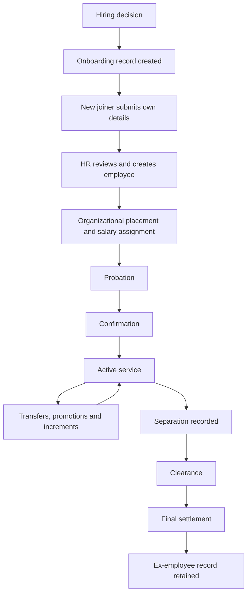
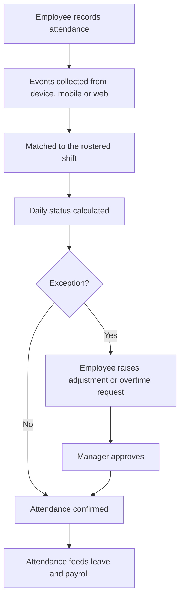
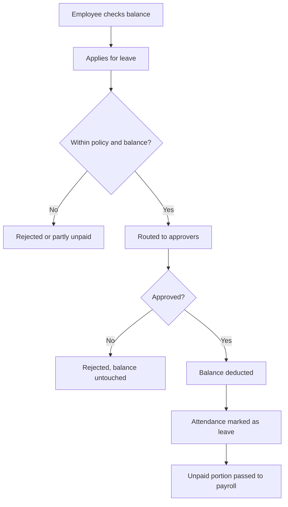
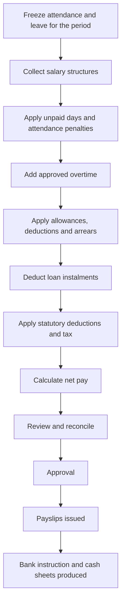
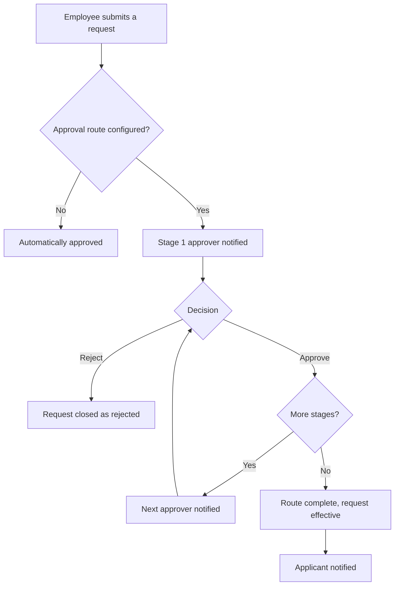
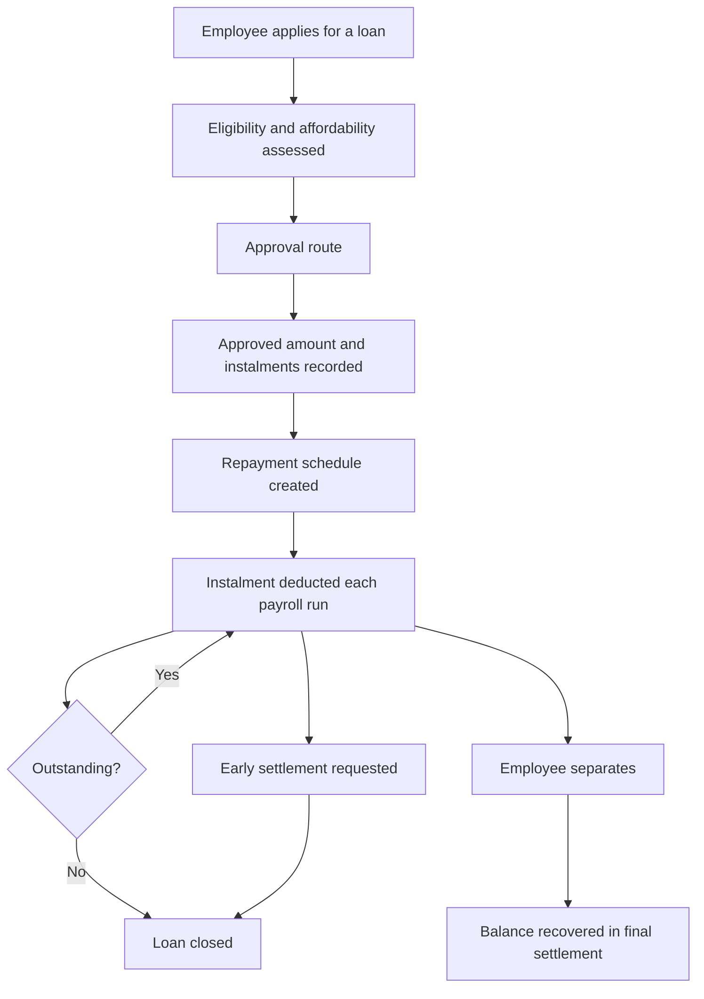
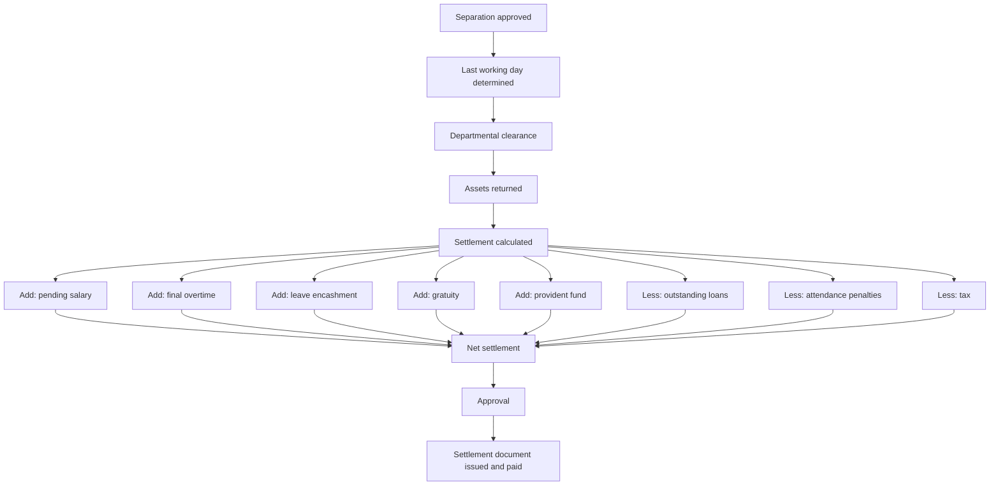
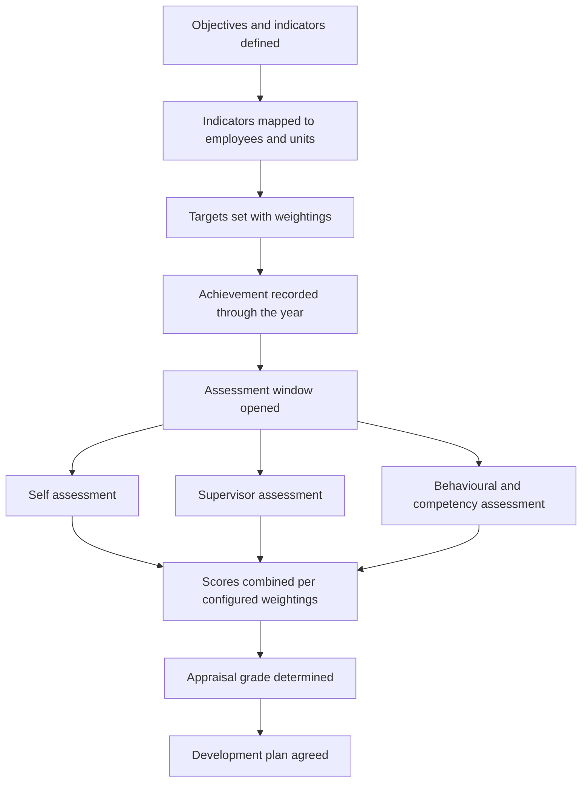
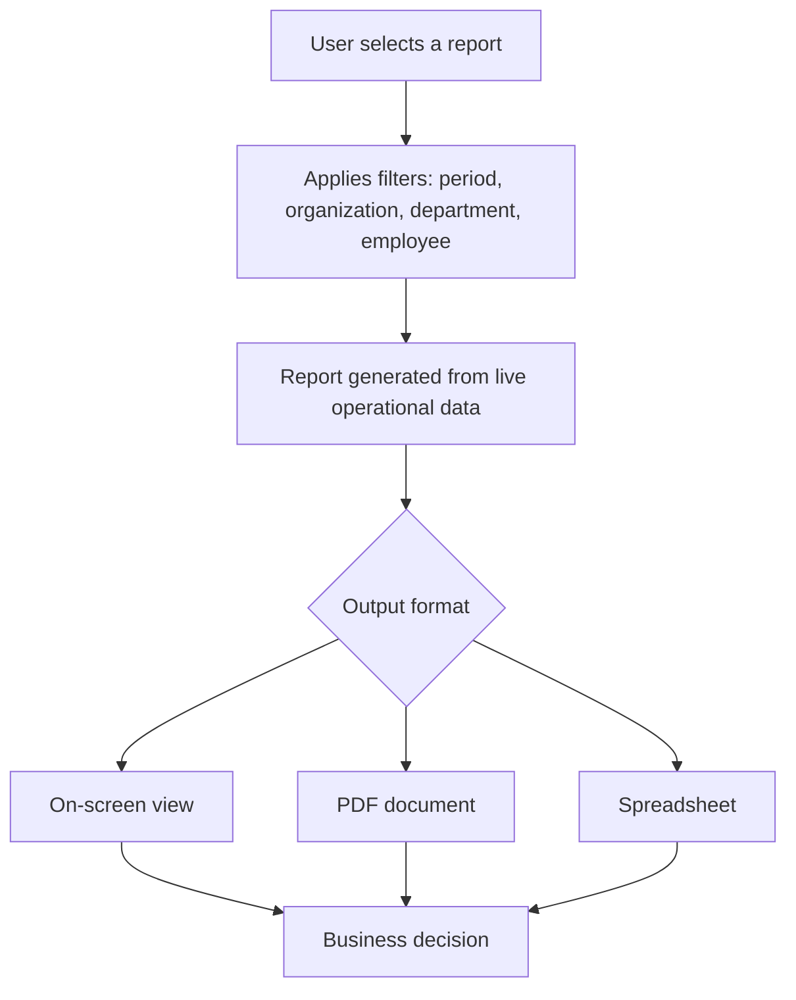
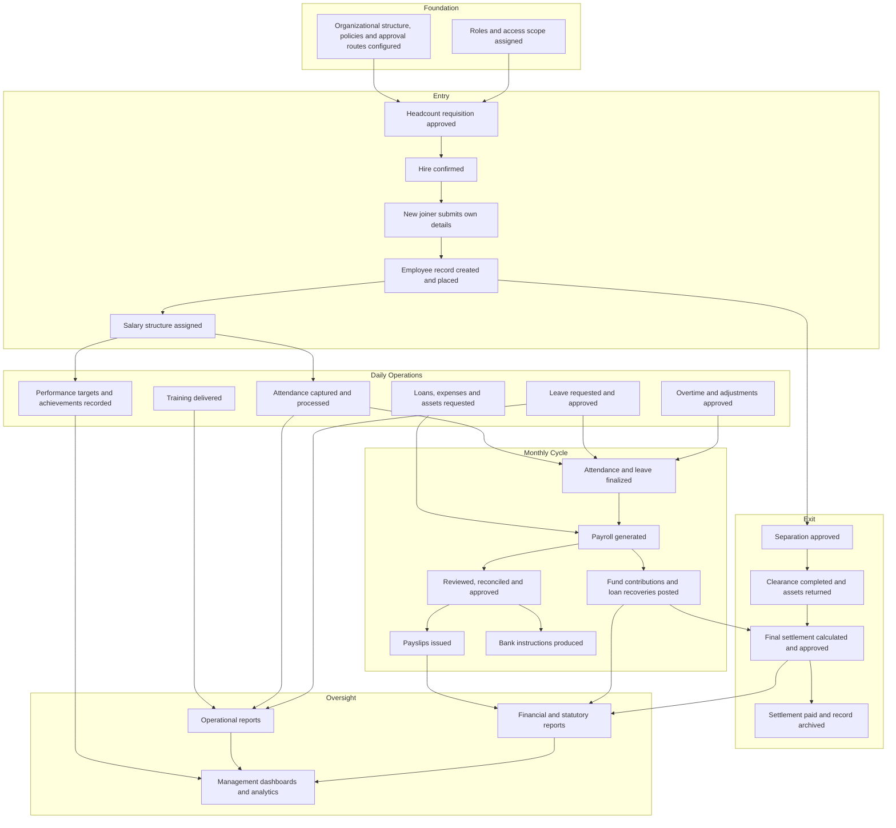

# PeopleDesk

## Human Resource Management System (HRMS) — Product Documentation

| | |
|---|---|
| **Product Name** | PeopleDesk |
| **Document Title** | PeopleDesk Human Resource Management System (HRMS) — Product Documentation |
| **Document Type** | Official Product Handbook (client-facing) |
| **Generated Date** | 22 July 2026 |
| **Product Version** | 2.0 |
| **Document Version** | 1.0 |
| **Audience** | Customers, business users, product owners, management, sales and pre-sales teams, implementation consultants |

**Document Purpose**

This handbook describes the PeopleDesk solution in business terms. It explains what the product does, which business modules it provides, what each feature is used for, which business rules govern its behaviour, how work flows end to end, and what value the solution delivers to an organization.

It is written for readers with no technical background. No programming or system knowledge is required.

**A note on scope.** This document describes only capabilities that are confirmed to exist in the delivered solution. Where a capability could not be confirmed, the document states *"Information not available in the current application."* rather than making an assumption. Capabilities that exist as configuration options but whose detailed policy behaviour varies by customer are described at the level that is common to all customers.

---

## Table of Contents

1. [Executive Summary](#1-executive-summary)
2. [Product Overview](#2-product-overview)
3. [Business Modules](#3-business-modules)
4. [Feature Catalog](#4-feature-catalog)
5. [Business Rules](#5-business-rules)
6. [Business Process Workflows](#6-business-process-workflows)
7. [User Journey](#7-user-journey)
8. [Navigation Overview](#8-navigation-overview)
9. [User Roles and Responsibilities](#9-user-roles-and-responsibilities)
10. [Reports and Analytics](#10-reports-and-analytics)
11. [Business Integrations](#11-business-integrations)
12. [Business Benefits](#12-business-benefits)
13. [End-to-End Business Flow](#13-end-to-end-business-flow)
14. [Glossary](#14-glossary)
15. [Conclusion](#15-conclusion)

---

## 1. Executive Summary

**PeopleDesk is a complete Human Resource Management System (HRMS)** that manages the full working life of an employee — from the moment a candidate is hired, through daily attendance, leave, performance and benefits, to final settlement on exit.

The solution is delivered as a subscription service. Each client organization operates in its own secure workspace with its own organizational structure, policies, approval rules and reporting, while sharing a single, continuously maintained product.

### Who uses it

PeopleDesk serves every level of an organization:

- **Employees** use self-service to apply for leave, correct attendance, request loans and assets, and view their own pay and records.
- **Managers** approve their team's requests and monitor team attendance and performance.
- **HR teams** maintain people data, run policies, administer benefits, and manage the employee lifecycle.
- **Payroll and finance teams** run monthly payroll, manage funds and loans, and produce statutory and banking outputs.
- **Management** uses dashboards and reports to monitor workforce cost, headcount, attendance discipline and performance.

### Business problems it solves

| Problem | How PeopleDesk addresses it |
|---|---|
| People data scattered across spreadsheets and departments | A single employee record that every module reads from |
| Manual attendance collection and reconciliation | Automated capture from time-recording devices, mobile and web, reconciled against shift and roster |
| Slow, undocumented approvals | A configurable approval engine covering more than forty request types, with full history |
| Error-prone, labour-intensive payroll | A structured monthly payroll run that consumes attendance, leave, loans and statutory rules automatically |
| Poor visibility of workforce cost and compliance | Approximately 130 standard reports covering people, time, pay, funds, assets and performance |
| Employees dependent on HR for routine requests | A full employee self-service portal on web and mobile |

### Key business benefits

- **Efficiency** — routine HR transactions move from email and paper into structured, tracked workflows.
- **Accuracy** — pay is calculated from recorded attendance, approved leave and configured policy rather than manual entry.
- **Compliance** — approvals, changes and access to sensitive data leave an audit trail; statutory outputs are produced from the same data used to pay employees.
- **Transparency** — employees see their own balances, payslips and request status without asking HR.
- **Control** — access is granted by role and limited to a defined part of the organization.

### Core business capabilities

Employee records and lifecycle · Organizational structure · Attendance and time management · Leave and movement · Payroll and tax · Allowances, deductions and bonuses · Loans and financial aid · Provident fund and gratuity · Employee benefits and facilities · Asset management · Expense management · Recruitment intake and onboarding · Performance management · Training and development · Approval workflow · Reporting and analytics · Notifications · Access control and administration.

---

## 2. Product Overview

### Product purpose

PeopleDesk exists to give an organization one reliable, governed system for everything related to its people: who they are, where they sit in the organization, when they work, what they are entitled to, what they are paid, what they are accountable for, and what they are owed when they leave.

Every module reads from the same employee record, so a change made once — a promotion, a transfer, a separation date — is reflected consistently across attendance, leave, payroll, benefits and reporting.

### Target organizations

The solution is designed for medium and large employers with structured HR and payroll operations, and is particularly suited to organizations that have:

- multiple business units, workplaces or locations under one corporate group;
- a mix of workforce categories — permanent staff, contract, workers, interns and consultants — with different policies for each;
- shift-based or roster-based operations alongside conventional office hours;
- statutory obligations for income tax, provident fund and gratuity;
- a need for formal, auditable approval of employee transactions.

The solution supports several organizations operating side by side on the same service, each fully separated from the others, and supports differing policy and reporting requirements between them.

### Typical users

| User | Uses PeopleDesk to |
|---|---|
| Employee | Apply for leave, adjust attendance, request loans, assets and expenses, view payslips and balances |
| Line manager / supervisor | Approve team requests, monitor team attendance and performance |
| HR officer | Maintain employee records, onboarding, confirmations, movements, separations |
| HR administrator | Configure organizational structure, policies, leave types, approval routes |
| Payroll officer | Assign salary structures, run monthly payroll, produce payslips and bank instructions |
| Benefits / fund administrator | Administer provident fund, gratuity policy, investments and profit distribution |
| Asset officer | Register, assign, maintain and dispose of company assets |
| Management | Review workforce cost, headcount, attendance and performance reporting |
| System administrator | Manage users, roles and access scope |

### Business objectives

1. Establish a single source of truth for workforce data.
2. Automate the high-volume, repetitive parts of HR and payroll operations.
3. Make every material employee transaction approved, dated and traceable.
4. Deliver pay accurately and on schedule, with statutory obligations met.
5. Give managers and executives current information rather than month-old spreadsheets.
6. Reduce the administrative burden on HR so it can focus on people rather than paperwork.

### Overall capabilities at a glance

| Dimension | Scale in the delivered solution |
|---|---|
| Business modules | 17 |
| Menu areas in the application | 21 top-level business areas, 639 menu entries (579 active) |
| Application screens | Approximately 780 |
| Standard reports and document outputs | Approximately 130 |
| Approval-routed request types | 44 |
| Automated background processes | 48 scheduled or continuous processes |
| Delivery model | Subscription service, multi-organization, web and mobile |

---

## 3. Business Modules

The solution is organized into seventeen business modules. Each is described below in terms of what it is for, what it is responsible for, the value it delivers, and which other business areas it connects to.

### 3.1 Employee Management

**Business purpose.** The system of record for people. Holds identity, employment details, organizational placement and personal information for every employee.

**Key responsibilities.** Employee records and documents; employment types; placement in department, designation, grade, location and cost centre; reporting relationships; probation and confirmation; transfers and promotions; separations; employee documents, letters and identity cards.

**Business benefits.** One accurate, current employee record removes duplicate data entry, keeps every other module consistent, and provides a defensible basis for pay, entitlement and reporting.

**Related business areas.** All modules depend on this one. Attendance, leave, payroll, benefits and access control all read the employee's status, placement and reporting line.

### 3.2 Organizational Framework

**Business purpose.** Defines the structural backbone — hierarchy, locations, grades, shifts, rosters and calendars — that other modules use for scoping, approvals and scheduling.

**Key responsibilities.** Business units, workplace groups, workplaces, departments, sections, divisions and positions; designations and pay-scale grades; cost centres; holiday calendars and weekly-off patterns; shift definitions and rostering; territory and job-location structures.

**Business benefits.** Changes to structure are made once and applied everywhere; approvals and reporting automatically follow the organization as it changes.

**Related business areas.** Attendance and leave (calendars and shifts), payroll (cost centres and pay groups), access control (scope), employee records (placement).

### 3.3 Attendance and Time Management

**Business purpose.** Captures when employees work, reconciles it against their scheduled shift, and feeds the result into leave and payroll.

**Key responsibilities.** Collection of clock events from time-recording devices, mobile and web; roster generation and assignment; daily attendance resolution (present, late, half day, absent, leave, holiday, weekly off); attendance adjustment and regularization requests; overtime capture, planning and approval; remote and field attendance; late and absence penalties; flexible timesheets.

**Business benefits.** Removes manual attendance registers and reconciliation, applies attendance policy consistently, and gives payroll a reliable input.

**Related business areas.** Leave (approved leave overrides absence), payroll (unpaid days, overtime and penalties affect pay), organizational framework (shifts, rosters, calendars), notifications (late and absence alerts).

### 3.4 Leave and Movement

**Business purpose.** Manages entitlements, requests, approvals and balances for all categories of leave, and for official movement away from the workplace.

**Key responsibilities.** Leave types and policies; entitlement and accrual; balance maintenance and year-end processing; leave application, approval and cancellation; leave encashment; movement (official duty) applications; bridge-leave and holiday-penalty handling.

**Business benefits.** Employees see accurate balances before applying; managers approve within policy; unpaid absence flows automatically into payroll; year-end carry-forward and lapse are processed consistently.

**Related business areas.** Attendance, payroll, employee records, notifications.

### 3.5 Payroll and Tax

**Business purpose.** Computes salaries from the compensation structure, attendance, leave and statutory rules, then produces payslips and disbursement instructions. The highest-value and highest-compliance module in the solution.

**Key responsibilities.** Salary structure and element setup; salary assignment, increments and grade-based pay; monthly salary generation; arrear and retroactive processing; bonus generation; advance salary; income-tax deduction and certificates; payslips, salary certificates, bank advice and cash-payment sheets; payroll reconciliation and summary reporting.

**Business benefits.** Pay is produced from recorded facts rather than manual compilation, is reproducible and auditable, and can be reconciled month over month.

**Related business areas.** Attendance, leave, loans, benefits (provident fund), employee records, organizational framework, approval workflow.

### 3.6 Allowance, Deduction and Bonus

**Business purpose.** Manages the variable elements of pay that sit alongside the fixed salary structure.

**Key responsibilities.** Definition of earning and deduction elements and their rules; fixed and one-off additions and deductions; bonus setup and generation; off-day allowances; approval routing for salary additions and deductions.

**Business benefits.** Variable pay is handled within policy and approval rather than as manual payroll adjustments.

**Related business areas.** Payroll, approval workflow, attendance.

### 3.7 Loan and Financial Aid

**Business purpose.** Administers employee borrowing in two forms — general cash loans with guarantors, and loans taken against the employee's own provident fund balance — and recovers them through payroll.

**Key responsibilities.** Loan types; loan application with requested and approved amounts, instalments and guarantors; loan approval; instalment schedules, rescheduling and holds; provident-fund loan eligibility and amortization schedule; early settlement; instalment recovery through the monthly payroll run; loan history and lifecycle reporting.

**Business benefits.** Gives employees a governed route to financial support while ensuring the organization recovers instalments automatically and tracks outstanding balances accurately.

**Related business areas.** Payroll (recovery), benefits (provident-fund balance), retirement (recovery at final settlement), approval workflow.

### 3.8 Benefits Management

**Business purpose.** Administers employee benefit funds and facilities.

**Key responsibilities.** Provident-fund policy, eligibility and member ledgers; fund investment and collection of returns; distribution of investment profit to members; gratuity policy setup by service band and employment type; cafeteria and meal-subsidy pricing, consumption and reporting; security-money deposits and their disbursement.

**Business benefits.** Funds held on behalf of employees are administered transparently, with member-level balances, documented investment activity and auditable distributions.

**Related business areas.** Payroll (contributions), retirement (payout at exit), loans (fund balance as collateral), approval workflow.

**Insurance note.** The solution records an employee's insurance reference on the employee identification profile, and benefit schemes are administered through the funds and facilities listed above. **Insurance policy administration, premium management, enrolment and claims processing are not part of the current application.**

### 3.9 Retirement, Separation and Final Settlement

**Business purpose.** Manages the end of employment and calculates what the organization owes, or is owed by, a departing employee.

**Key responsibilities.** Separation types and policies; separation application and approval; last-working-day determination; separation clearance across departments; gratuity calculation; provident-fund settlement; final settlement computation and documentation; exit interviews.

**Business benefits.** Exits are handled consistently and completely, with all outstanding balances, recoveries and entitlements brought into a single settlement figure and document.

**Related business areas.** Payroll, leave, loans, benefits, assets, approval workflow.

### 3.10 Recruitment Intake and Onboarding

**Business purpose.** Converts a hiring decision into a complete employee record, and manages headcount requests.

**Key responsibilities.** Employee (manpower) requisition with approval; creation of a pre-employment record; a shareable self-fill form allowing the new joiner to submit their own personal, educational, employment-history and document information before joining; HR review and promotion of that record into a live employee; intake of candidates already hired in the organization's recruitment system.

**Business benefits.** New joiners arrive with their data already captured and verified, reducing first-day administration and improving data completeness.

**Related business areas.** Employee management, approval workflow, external recruitment system.

**Note.** Candidate sourcing, job advertising, applications and interview management take place in a separate recruitment system; PeopleDesk consumes the hiring outcome rather than running the recruitment funnel itself.

### 3.11 Performance Management

**Business purpose.** Plans, measures and evaluates employee performance, and supports development conversations.

**Key responsibilities.** Objective and key-performance-indicator catalogue; mapping of indicators to employees, departments, designations and business units; annual target setting with weightings and benchmarks; achievement entry and scorecards; behavioural assessment questionnaires; values and competency assessment by employee and supervisor; multi-stakeholder evaluation routing with weightings; assessment timelines; appraisal grading bands; coaching tools including the Johari window, the GROW model, work plans, action plans and individual development plans.

**Business benefits.** Performance is measured against agreed, weighted objectives rather than impressions, and development actions are recorded and followed up.

**Related business areas.** Employee management, organizational framework, training and development.

### 3.12 Training and Development

**Business purpose.** Runs the training lifecycle from request through delivery to assessment and reporting.

**Key responsibilities.** Training types, titles, cost categories and trainer directory; training requisitions; training planning with venue, mode, objectives, participants, trainers and costs; session scheduling and calendar; attendance tracking per session; post-training assessment and participant feedback; training dashboard, inventory, cost and diary reporting.

**Business benefits.** Training spend and participation are visible, effectiveness is measured, and development activity is documented against the employee record.

**Related business areas.** Employee management, performance management.

### 3.13 Asset Management

**Business purpose.** Tracks company assets from acquisition through assignment, maintenance and depreciation to disposal.

**Key responsibilities.** Item catalogue with categories and units; asset registration with acquisition value, warranty and identification code; asset requisition by employees with approval; assignment (by requisition or directly), acknowledgement, transfer and return; maintenance records and costs; periodic depreciation and book value; disposal; asset register and per-employee asset profile reporting.

**Business benefits.** The organization knows what it owns, who holds it, what it is worth and what it costs to maintain — and recovers assets reliably when employees leave.

**Related business areas.** Employee management, separation clearance, approval workflow.

### 3.14 Expense Management

**Business purpose.** Handles employee expense claims and temporary cash advances.

**Key responsibilities.** Expense types; expense applications; advance (IOU) requests and their subsequent adjustment; approval routing; expense reporting.

**Business benefits.** Claims are submitted, approved and reported through a controlled route rather than informally.

**Related business areas.** Approval workflow, payroll, employee self-service.

### 3.15 Approval Workflow

**Business purpose.** The shared, configurable engine through which every material employee transaction is authorized. It is the governance backbone of the solution.

**Key responsibilities.** Definition of approval routes per request type and per part of the organization; ordered or non-sequential approval stages; approver types including supervisor, line manager, dotted-line supervisor, user group and named individual; a consolidated pending-work dashboard for approvers; single and bulk approve or reject; administrator override; complete approval history; automatic notification of the next approver.

**Coverage.** Forty-four request types are routed through the engine, including leave, movement, attendance adjustment, overtime and overtime planning, shift change and exchange, remote and field attendance, salary generation, bonus, arrears, increment and increment proposal, advance salary, salary additions and deductions, salary certificates, loans and provident-fund loans, provident-fund withdrawal and profit share, security deposits and disbursements, expense claims and advances, asset requisitions, employee requisitions, transfers and promotions, profile changes, document and no-objection requests, separation, separation clearance and final settlement.

**Business benefits.** Every consequential change is authorized by the right person, recorded with a timestamp, and available for audit. Approval rules can be changed by configuration as the organization evolves.

**Related business areas.** Every transactional module, plus notifications and audit.

### 3.16 Administration, Configuration and Access Control

**Business purpose.** The configuration and governance layer: reference data, organizational setup, users, roles and access scope.

**Key responsibilities.** Master and reference data across the organization; employment, separation, loan, expense and document types; leave and movement types and policies; company policy documents with employee acknowledgement; bank and tax configuration; announcements; user accounts, user groups, roles and feature permissions; the scope of the organization each role may act on; notification categories and channels; delivery and activity monitoring.

**Business benefits.** The solution can be adapted to each organization's structure and policy without custom development, and access can be kept to the minimum each role requires.

**Related business areas.** All modules.

### 3.17 Workplace Services, Dashboards and Monitoring

**Business purpose.** A group of cross-cutting services that support day-to-day working life and give each audience a starting view of the information relevant to them.

**Key responsibilities.** Role-specific dashboards for employees, supervisors and management, plus a service-book view; task and project management; grievance submission and handling; a confidential whistleblower channel with configured recipients; an employee directory and contact book; a custom report builder with letter templates and letter generation; announcements; and monitoring of notification delivery and application activity.

**Business benefits.** Employees have a confidential route to raise concerns; managers and executives open the system to the information they actually need; teams coordinate work in the same place they manage people; and organizations can build their own reports and correspondence templates without waiting for new development.

**Related business areas.** Employee management, self-service, administration, notifications, reporting.

---

## 4. Feature Catalog

The tables below list the principal features available in each module. Features are described by what they achieve for the business.

### 4.1 Employee Management

| Feature | Business purpose | Description | Business benefit | Typical users |
|---|---|---|---|---|
| Employee record | Maintain the master record for each person | Identity, employment, organizational placement, contact, education, experience and family details | Single trusted source of people data | HR officer, HR admin |
| Employee documents | Hold supporting documentation | Upload and retrieve certificates, identity documents and agreements against the employee | Documentation is complete and retrievable | HR officer |
| Identification profile | Record statutory and personal identifiers | National identity, birth registration, passport, tax and insurance reference numbers | Compliance and correct statutory treatment | HR officer, employee |
| Confirmation | Move employees from probation to permanent status | Track probation end, process confirmation and issue confirmation letters | Entitlements begin on the correct date | HR officer, manager |
| Transfer and promotion | Record organizational and grade movement | Effective-dated movement with approval and letter generation | Movements are authorized and auditable | HR officer, approver |
| Increment | Record pay revisions | Individual or bulk increments, including grade-based increments, with approval and letters | Pay revisions applied consistently and on time | Payroll officer, HR |
| Reward and punishment | Record recognition and disciplinary outcomes | Capture actions against the employee and generate the associated letters | Consistent, documented people decisions | HR officer, manager |
| Job description | Define and assign role expectations | Job description library, extension and assignment to employees | Clear role accountability | HR admin, manager |
| Employee identity card | Produce staff identity cards | Generate printable identity cards from employee data and photograph | Fast, consistent card issuance | HR officer |
| Letters and documents | Issue formal employment correspondence | Confirmation, transfer, promotion, increment and separation letters from templates | Professional, consistent correspondence | HR officer |
| Organogram | Visualize reporting structure | Display the organization's reporting hierarchy | Clarity of structure and span of control | Management, HR |
| Contact book | Locate colleagues | Directory of employees and contact details | Everyday productivity | All employees |

### 4.2 Attendance and Time Management

| Feature | Business purpose | Description | Business benefit | Typical users |
|---|---|---|---|---|
| Attendance capture | Record when people work | Collect clock events from time-recording devices, mobile and web | Removes manual registers | All employees |
| Roster setup and generation | Schedule who works when | Define rosters and generate monthly schedules across the workforce | Coverage is planned, not improvised | HR admin, manager |
| Calendar and holiday setup | Define non-working time | Holiday calendars, weekly offs, exception off-days and their assignment | Attendance and leave counted correctly | HR admin |
| Daily attendance processing | Turn raw events into a status | Reconcile events against shift and roster to produce a daily status | Reliable payroll input | System, HR |
| Attendance adjustment | Correct missing or wrong entries | Employee-raised correction request routed for approval | Errors corrected within policy, not informally | Employee, manager |
| Overtime entry and planning | Manage work beyond schedule | Record, plan and review overtime with approval | Overtime controlled and correctly paid | Employee, manager |
| Remote and field attendance | Support work away from the workplace | Location-based attendance, market visits and device registration with approval | Field and remote work is measurable | Field staff, manager |
| Shift change and exchange | Handle schedule variation | Requests to change or swap shifts, routed for approval | Operational flexibility with control | Employee, manager |
| Late and absence penalties | Apply attendance discipline | Configured penalties applied through payroll | Consistent, policy-based discipline | HR, payroll |
| Flexible timesheet | Support non-standard working patterns | Bulk timesheet entry and processing for flexible arrangements | Accommodates varied work models | HR admin |
| Extra side duty | Record additional duty | Capture duty performed beyond the normal assignment | Additional effort is recognized | Manager, HR |

### 4.3 Leave and Movement

| Feature | Business purpose | Description | Business benefit | Typical users |
|---|---|---|---|---|
| Leave types and policies | Define what leave exists and its rules | Configure leave categories, entitlement, accrual method and eligibility | Policy applied uniformly | HR admin |
| Leave balance generation | Maintain entitlement balances | Automatic scheduled, monthly-incremental and calculative balance generation | Balances always current | System, HR |
| Leave application | Request time off | Apply for leave with dates and type; validated against balance and policy | Fewer rejected or invalid requests | Employee |
| Leave approval | Authorize time off | Route to the configured approvers with full history | Coverage protected, decisions recorded | Manager, HR |
| Leave encashment | Convert unused leave to pay | Request and approve encashment of eligible balances | Recognized entitlement, paid correctly | Employee, HR, payroll |
| Movement application | Record official absence from the workplace | Apply for and approve official duty movement | Attendance not penalized for official duty | Employee, manager |
| Leave policy auto-renewal | Handle cycle rollover | Renew policies and carry balances into the new cycle | No manual year-end rework | HR admin |
| Bridge leave handling | Handle leave adjoining holidays | Apply configured treatment where leave adjoins holidays or off-days | Policy applied consistently | System, HR |

### 4.4 Payroll and Tax

| Feature | Business purpose | Description | Business benefit | Typical users |
|---|---|---|---|---|
| Payroll element and rule setup | Define the shape of pay | Configure earning and deduction elements and their calculation rules | Pay structures reflect actual policy | Payroll admin |
| Payroll group and pay frequency | Group employees for processing | Define processing groups and their pay calendars | Orderly, segmented processing | Payroll admin |
| Salary assignment | Set each employee's pay | Assign salary structure individually, in bulk, or by grade | Accurate starting point for every run | Payroll officer |
| Monthly salary generation | Produce the payroll | Generate salaries for a group, month and year from all inputs | Fast, repeatable monthly close | Payroll officer |
| Arrear processing | Handle retroactive pay | Generate arrears where changes take effect in a past period | Back-pay handled correctly | Payroll officer |
| Bonus generation | Pay bonuses | Configure and generate bonus runs with approval | Bonuses paid accurately and on time | Payroll officer |
| Advance salary | Provide early access to pay | Request, approve and recover advance salary | Employee support with controlled recovery | Employee, payroll |
| Income tax | Meet tax obligations | Tax deduction, challan configuration, tax certificates and full-year tax reporting | Statutory compliance from payroll data | Payroll, finance |
| Payslip | Inform employees | Individual and bulk payslips, including cash-payment formats | Transparency and fewer pay queries | Employee, payroll |
| Salary certificate | Support employee needs | Approved salary certificates for banks and third parties | Fast response to employee requests | Employee, HR |
| Bank advice and disbursement | Pay employees | Bank instruction files in multiple bank-specific formats, plus cash payment sheets | Timely, error-free disbursement | Payroll, finance |
| Salary reconciliation | Verify the run | Compare and reconcile the payroll before release | Errors caught before payment | Payroll officer |

### 4.5 Loan and Financial Aid

| Feature | Business purpose | Description | Business benefit | Typical users |
|---|---|---|---|---|
| Loan request | Apply for a cash loan | Amount, instalments, interest, guarantor and closing date | Governed access to financial support | Employee |
| Loan approval | Authorize lending | Approval route with recorded approved amount and instalments | Lending within policy and affordability | Approver, HR |
| Loan schedule and reschedule | Plan and adjust repayment | Instalment schedules, rescheduling and holding of instalments | Flexibility when circumstances change | HR, payroll |
| Provident-fund loan | Borrow against own fund balance | Eligibility calculation and full repayment schedule | Access to own savings without external borrowing | Employee, fund admin |
| Early settlement | Close a loan ahead of schedule | Settle outstanding principal and interest, with optional concession | Clean closure, reduced administration | Employee, fund admin |
| Payroll recovery | Collect instalments | Due instalments deducted automatically in the monthly run | No manual tracking or chasing | System, payroll |
| Loan reporting | Monitor lending | Loan history, per-loan detail and fund-loan lifecycle reports | Visibility of exposure and recovery | Finance, HR |

### 4.6 Benefits Management

| Feature | Business purpose | Description | Business benefit | Typical users |
|---|---|---|---|---|
| Provident-fund policy | Define fund rules | Eligibility basis, contribution percentages and assignment | Consistent, policy-based fund administration | Fund admin |
| Member ledger | Track member balances | Contributions, withdrawals and earnings per member and period | Members and administrators see true balances | Fund admin, employee |
| Fund investment | Grow the fund | Record investments, instruments, returns, maturity and collections | Fund performance is documented | Fund admin, finance |
| Profit distribution | Share investment returns | Distribute earned profit to member balances, with approval | Transparent, authorized distribution | Fund admin, approver |
| Gratuity policy | Define end-of-service benefit | Service-length bands and disbursement basis by employment type | Predictable, policy-based settlement | HR, fund admin |
| Cafeteria management | Run staff catering | Pricing by designation, company and employee contribution, meal entry and consumption reporting | Controlled subsidy and clear cost visibility | HR admin, employee |
| Security deposits | Manage employee deposits | Deposit types, collection and disbursement with approval | Deposits held and returned accountably | HR, finance |
| Fund reporting | Report on funds | Investment reports, employee-wise fund detail and annual member statements | Governance and member confidence | Fund admin, finance |

### 4.7 Retirement, Separation and Final Settlement

| Feature | Business purpose | Description | Business benefit | Typical users |
|---|---|---|---|---|
| Separation types and policy | Define how exits are handled | Configure separation categories and notice policy | Consistent treatment of exits | HR admin |
| Separation application | Initiate an exit | Record resignation or termination with reason and dates, routed for approval | Exits are authorized and dated | Employee, HR, approver |
| Last-working-day calculation | Determine the exit date | Derive the last working day from the policy | Correct basis for pay and entitlement | HR |
| Separation clearance | Confirm nothing is outstanding | Departmental clearance covering assets and dues | No unrecovered assets or advances | HR, department heads |
| Gratuity calculation | Calculate the service benefit | Apply the gratuity policy band to service length | Correct, policy-based entitlement | HR, payroll |
| Provident-fund settlement | Release the member balance | Settle the employee's fund position on exit | Timely, accurate release of savings | Fund admin |
| Final settlement | Produce the closing figure | Consolidate dues, overtime, leave encashment, gratuity and fund against loans, penalties and tax | One complete, defensible settlement | Payroll, HR, finance |
| Exit interview | Capture leaver feedback | Structured questionnaire at exit | Insight into attrition drivers | HR |

### 4.8 Asset Management

| Feature | Business purpose | Description | Business benefit | Typical users |
|---|---|---|---|---|
| Item catalogue | Define asset types | Categories, sub-categories, units and item definitions | Consistent asset classification | Asset officer |
| Asset registration | Record owned assets | Acquisition value, warranty, depreciation rate and identification code | Complete asset register | Asset officer |
| Identification code | Identify assets quickly | Scannable code linked to an asset detail page | Fast verification and stock-taking | Asset officer |
| Asset requisition | Request equipment | Employee request routed for approval | Governed allocation of equipment | Employee, approver |
| Assignment and acknowledgement | Issue assets | Assign against a requisition or directly, with employee acknowledgement | Clear custody and accountability | Asset officer, employee |
| Transfer and return | Move assets between holders | Transfer between employees or release back to stock | Accurate custody at all times | Asset officer |
| Maintenance | Keep assets serviceable | Record maintenance jobs, providers, costs and return to service | Controlled maintenance spend | Asset officer |
| Depreciation | Value assets over time | Calculate and post periodic depreciation and book value | Accurate asset valuation | Finance, asset officer |
| Disposal | Retire assets | Record sale or write-off with amount and disposal type | Clean, documented retirement | Finance, asset officer |
| Asset reporting | Monitor the estate | Register, detail, depreciation and per-employee asset reports | Full visibility of the asset base | Management, finance |

### 4.9 Performance Management

| Feature | Business purpose | Description | Business benefit | Typical users |
|---|---|---|---|---|
| Objective and indicator catalogue | Define what is measured | Hierarchical objectives and performance indicators with measurement basis | Measurement aligned to strategy | HR, management |
| Indicator mapping | Assign measures | Map indicators to employees, departments, designations or business units | Everyone knows what they are measured on | HR, manager |
| Target setting | Agree the standard | Annual targets with weighting, frequency and benchmark | Fair, agreed expectations | Manager, employee |
| Achievement entry and scorecard | Record and view results | Enter actual achievement against target; view individual scorecards | Continuous visibility of performance | Employee, manager |
| Evaluation criteria and scales | Define how scores are formed | Criteria, weighting between measured results and behaviours, and score bands | Balanced, transparent evaluation | HR admin |
| Evaluation routing | Decide who evaluates whom | Stakeholder types with score weightings per position group | Multi-perspective assessment | HR admin |
| Assessment timeline | Control the review window | Open and close assessment periods with activity log | Reviews happen on schedule | HR admin |
| Behavioural assessment | Assess how work is done | Questionnaire-based behavioural rating by self and supervisor | Behaviour assessed alongside results | Employee, supervisor |
| Values and competency assessment | Assess capability | Desired versus demonstrated values and competencies | Clear development gaps | Employee, supervisor, HR |
| Appraisal grading | Convert scores to outcomes | Score bands mapped to grades and appraisal percentages | Consistent appraisal outcomes | HR, management |
| Coaching tools | Support development | Johari window, GROW model, work plans, action plans and individual development plans | Structured development conversations | Manager, employee |
| Performance analytics | Review the picture | Indicator charts, yearly performance, appraisal reports and talent grid views | Informed talent decisions | Management, HR |

### 4.10 Training and Development

| Feature | Business purpose | Description | Business benefit | Typical users |
|---|---|---|---|---|
| Training master data | Define the training catalogue | Types, titles, cost categories, and internal and external trainers | Reusable, consistent catalogue | Training admin |
| Training requisition | Request training | Request with type, reason and objectives, linked to planned events | Demand-driven training planning | Employee, manager |
| Training planning | Organize a training event | Mode, organizer, venue, objectives, dates, participants, trainers and costs | Well-organized, costed events | Training admin |
| Session scheduling | Set the timetable | Session dates and times with calendar view | Clear scheduling and attendance planning | Training admin |
| Attendance tracking | Confirm participation | Mark attendance per session, individually or in bulk | Verified participation records | Training admin |
| Assessment and feedback | Measure effectiveness | Post-training assessment and participant feedback | Evidence of training value | Participant, admin |
| Training analytics | Report on training | Dashboard, inventory, cost and training-diary reporting | Justifiable training investment | Management, HR |

### 4.11 Employee Self-Service

| Feature | Business purpose | Description | Business benefit | Typical users |
|---|---|---|---|---|
| About me | Maintain own profile | View and request updates to own personal information, with approval | Accurate data, less HR data entry | Employee |
| My requests | Transact independently | Leave, movement, attendance adjustment, overtime, loan, expense and asset requests | Faster service, lower HR load | Employee |
| My records | See own information | Payslips, leave balances, attendance, loan history, asset holdings and rewards | Transparency and trust | Employee |
| My documents | Obtain formal documents | Request salary certificates, no-objection letters and other documents | Fast turnaround on routine requests | Employee |
| Approvals inbox | Act on team requests | Consolidated view of everything awaiting the user's decision | Nothing waits unnoticed | Manager |
| Notifications | Stay informed | In-application, mobile, e-mail and message alerts on request activity | Timely action, fewer delays | All users |

### 4.12 Administration and Access Control

| Feature | Business purpose | Description | Business benefit | Typical users |
|---|---|---|---|---|
| Organizational setup | Model the organization | Business units, workplaces, departments, sections, designations, positions and grades | The system matches the real organization | HR admin |
| Reference data | Maintain standard lists | Employment, separation, loan, expense and document types; geographic and demographic lists | Consistent, controlled data entry | HR admin |
| Approval route configuration | Define governance | Approval stages per request type and organizational scope | Governance adapts without development | HR admin |
| User and role management | Control access | Users, user groups, roles, feature permissions and role extension | Least-privilege access | System admin |
| Access scope | Limit reach | Restrict each role to defined business units, workplace groups and workplaces | Managers see only their population | System admin |
| Policy documents | Publish policy | Upload and categorize company policies with employee acknowledgement | Demonstrable policy communication | HR admin, employee |
| Announcements | Communicate | Publish announcements to a business unit | Consistent internal communication | HR admin |
| Notification configuration | Control communication | Choose which notification categories go out over which channel | Relevant alerts, less noise | System admin |
| Activity monitoring | Verify delivery | Monitor notification delivery and application activity logs | Confidence that alerts reached people | System admin |

### 4.13 Workplace Services, Dashboards and Monitoring

| Feature | Business purpose | Description | Business benefit | Typical users |
|---|---|---|---|---|
| Employee dashboard | Give each employee a starting point | Personal summary of pending items, balances and announcements | Faster daily use, fewer missed actions | Employee |
| Supervisor dashboard | Focus a manager on their team | Team attendance, pending approvals and exceptions in one view | Managers act on what matters first | Manager |
| Management dashboard | Support executive oversight | Configurable summary of workforce and cost indicators | Informed direction without report-chasing | Management |
| Service book | Consolidate an employee's service record | Chronological view of an individual's employment history | Quick answers on tenure and history | HR, management |
| Task and project management | Coordinate work | Task boards and projects alongside people management | Work and people managed in one place | All users |
| Grievance | Give employees a formal route to raise issues | Submit and track a grievance through to resolution | Issues surface and are handled, not buried | Employee, HR |
| Whistleblower channel | Enable confidential reporting | Confidential submission routed to configured recipients | Governance and early risk detection | Employee, management |
| Employee directory and contact book | Help people find colleagues | Searchable directory of employees and contact details | Everyday productivity | All employees |
| Custom report builder | Meet reporting needs without development | Build reports beyond the standard set | Self-sufficiency in reporting | HR admin, management |
| Letter configuration and generation | Standardize correspondence | Define letter templates and generate them against employee data | Consistent, fast correspondence | HR |
| Announcements | Communicate to the workforce | Publish announcements to a business unit | Reliable internal communication | HR admin |
| Notification and activity monitoring | Confirm communication worked | Monitor delivery of notifications and application activity | Confidence that alerts reached people | System admin |

---

## 5. Business Rules

The following rules govern the solution's behaviour. Rules marked as configurable are set per organization during implementation.

### Access and governance

1. Access is granted through roles, never to individuals directly.
2. What a user may do is the combination of a permission and a scope — a manager may approve, but only for their own population.
3. Each role is limited to a defined part of the organization (business unit, workplace group and workplace).
4. Users cannot act in the system once their organization's subscription has expired or been suspended.
5. All access and activity is scoped to the user's own organization; organizations cannot see one another's data.
6. Sensitive information, including salary, is treated as restricted and is stored in protected form.

### Approvals

7. Material transactions take effect only after their approval route has completed without rejection.
8. If no approval route is configured for a request type in a given part of the organization, the request is automatically approved.
9. Approval stages progress in the configured sequence; only the current stage may act.
10. Administrators may act on a stage outside the normal route, and such action is recorded separately.
11. Every approval and rejection is retained in an immutable history against the application.
12. Each stage activation notifies the next approver.

### Employee lifecycle

13. The employee identifier is unique and does not change once assigned.
14. An active employee has one primary reporting manager; an employee cannot report to themselves.
15. Joining and confirmation dates start the clocks for service-based entitlements such as gratuity and earned leave.
16. Employment type and payroll group determine which pay and entitlement rules apply to an employee.
17. Records are deactivated rather than deleted, and historical versions are retained.
18. Organizational and compensation changes are effective-dated so that history remains accurate.
19. A separation date ends self-service access and triggers final settlement and clearance.
20. New employees cannot be created beyond the organization's subscribed employee limit.

### Attendance and time

21. A day's attendance status is derived from recorded clock events evaluated against the assigned shift and roster, then overlaid with approved leave and holidays.
22. An arrival within the configured grace period is not treated as late.
23. Half-day status is triggered by the worked-hours or arrival-time thresholds defined on the shift.
24. A missing clock event produces an incomplete day that requires correction or manager action.
25. Overtime requires approval and may be subject to configured limits.
26. Night shifts crossing midnight are attributed to the shift's business date, not the calendar date of each event.
27. Attendance corrections are subject to a cut-off window and an approval route.

### Leave

28. Leave eligibility may depend on employment type, grade, length of service, confirmation status and gender.
29. Requests are validated against the available balance; the portion beyond balance becomes unpaid leave.
30. Overlapping leave requests for the same dates are rejected.
31. Balances are recalculated whenever leave accrues, is carried forward, is encashed or is cancelled.
32. Leave balances are generated automatically on a scheduled basis according to the policy's accrual method.
33. Approved leave marks the corresponding attendance days as leave.

### Payroll

34. The base salary component drives derived components according to the configured rules.
35. Unpaid absence reduces pay using the divisor defined by the applicable policy — it is not a fixed assumption.
36. Attendance, approved leave, overtime, penalties, loan instalments and statutory deductions are all inputs to the monthly run.
37. A payroll run is scoped to one organization, month, year and processing group.
38. Once a run is finalized its inputs are frozen; later corrections are made as arrears in a subsequent run.
39. Employees joining or leaving mid-period are paid on a pro-rated basis.
40. Salary generation and bonus generation are themselves subject to approval.
41. Every run must be reproducible and auditable.

### Loans and funds

42. An employee may hold only one active provident-fund loan at a time.
43. The borrowable amount against the provident fund is the member's contributions and share of returns, less the outstanding principal of existing fund loans.
44. Loan instalments are recovered automatically in the monthly payroll run.
45. Early settlement must be less than the total outstanding instalment value.
46. Outstanding loan balances are recovered from the final settlement on exit.
47. Provident-fund profit distribution requires approval before it is applied to member balances.

### Assets

48. Items that are already assigned cannot be edited or removed without releasing them first.
49. An asset must be free before it can be assigned; assignment, maintenance and disposal each change its availability.
50. Asset current value is the book value less accumulated depreciation.
51. Asset holdings are checked during separation clearance.

### Data integrity

52. Approved and completed transactions are retained as history rather than overwritten.
53. Every business record belongs to exactly one organization.
54. Reference data changes apply organization-wide and take effect immediately for new transactions.

---

## 6. Business Process Workflows

This section describes the major end-to-end processes the solution supports.

### 6.1 Employee lifecycle

From hire to exit, each stage hands over to the next with the employee record as the constant.



**Business notes.** Joining and confirmation dates begin service-based entitlements. Every movement is effective-dated and approved, so history remains accurate and pay changes flow into the correct period.

### 6.2 Attendance process



**Business notes.** Attendance is processed continuously rather than at month end, so exceptions surface while they can still be corrected easily. Rosters are generated automatically at the start of each month.

### 6.3 Leave management



**Business notes.** Balances are maintained automatically by scheduled accrual. Cancellation restores the balance and reverses the attendance marking.

### 6.4 Monthly payroll processing



**Business notes.** The run is requested for a month, year and processing group, then processed automatically in the background. Because the run consumes attendance, leave, overtime, loans and tax rules, a change in any of those areas can move net pay — which is why the run is reviewed and approved before release.

### 6.5 Approval process



**Business notes.** The same engine serves all forty-four routed request types, so approval behaves identically whether the request is a day of leave or a final settlement. Approvers see all their pending work in one place and can act individually or in bulk.

### 6.6 Loan lifecycle



### 6.7 Final settlement



**Business notes.** This is the most cross-functional process in the solution, drawing balances from payroll, attendance, leave, loans and benefits into a single figure supported by a printable settlement statement.

### 6.8 Performance management cycle



### 6.9 Reporting process



---

## 7. User Journey

### 7.1 An employee's day

1. **Sign in.** The employee signs in to the web application or mobile app. Where the organization has enabled it, sign-in can be confirmed with a one-time code.
2. **Land on the overview.** The home view shows current status: pending requests, notifications, announcements and upcoming holidays.
3. **Record attendance.** The employee clocks in — at a workplace device, or from mobile where location-based attendance is permitted for their role.
4. **Handle exceptions.** If yesterday's attendance shows a missing entry, the employee raises an adjustment request; it goes to their manager automatically.
5. **Apply for leave.** The employee checks their balance, selects a leave type and dates, and submits. The system validates the request against balance and policy before it is routed.
6. **Request support.** During the month the employee may request a loan, submit an expense claim, request an asset, or ask for a salary certificate — each through the same self-service area, each routed for approval.
7. **Stay informed.** Approvals, rejections and reminders arrive as in-application alerts and mobile notifications.
8. **Review pay.** After the monthly run, the payslip becomes available in self-service alongside leave balances, attendance history and loan status.
9. **Participate in performance.** During the assessment window the employee records achievements against targets, completes a self assessment, and agrees a development plan with their manager.

### 7.2 A manager's day

1. **Sign in and open the approvals inbox**, which shows everything awaiting a decision, grouped by request type.
2. **Review team attendance** — who is present, late, absent or on leave today.
3. **Act on requests** — approve or reject leave, attendance corrections, overtime, expenses and asset requests, individually or in bulk.
4. **Plan coverage** using the team leave calendar and roster before approving further absence.
5. **Manage performance** — set and revise targets, validate achievements, complete supervisor assessments and record coaching conversations.

### 7.3 An HR or payroll professional's month

1. **Maintain people data** — process joiners, confirmations, movements and separations as they arise.
2. **Monitor time** — review attendance exceptions, pending adjustments and overtime through the month.
3. **Close the period** — confirm attendance and leave are settled for the payroll month.
4. **Run payroll** — generate salaries for each processing group, review the reconciliation, resolve exceptions and submit for approval.
5. **Release pay** — publish payslips and produce bank instructions or cash sheets.
6. **Meet obligations** — produce tax, fund and statutory reporting from the same run.
7. **Report to management** — issue headcount, cost, attendance and turnover reporting.

---

## 8. Navigation Overview

The navigation below is the complete business menu structure of the solution, verified against the application's menu catalogue. The catalogue contains **639 menu entries across 21 top-level business areas**, of which **579 are active**.

**What a given user sees.** The menu is not the same for everyone. Two things filter it:

1. **Subscription package** — the areas activated for the customer organization at sign-up.
2. **Role and permission** — within an activated area, each role is granted only the screens it needs. A user sees a section only if they are permitted at least one screen inside it.

An individual user therefore sees a subset of the structure below. Counts in brackets are the number of menu entries in the catalogue for that area.

```
PeopleDesk
│
├── Overview [1]
│   └── Dashboard landing
│
├── Dashboard [6]
│   ├── Employee dashboard
│   ├── Supervisor dashboard
│   ├── Management dashboard
│   └── Service book
│
├── Employee Management [136]
│   ├── Employee · Employee Details · Confirmation · Onboarding
│   ├── Transfer & Promotion (transfer & promotion, joining)
│   ├── Separation (application, report) · Final Settlement
│   ├── Time Management (attendance adjust, attendance process,
│   │      attendance raw data process, bridge absent, flexible timesheet, shift exchange)
│   ├── Overtime Entry (manual entry, auto generated, overtime planning, special-day planning)
│   ├── Leave (leave application, leave adjustment) · Movement Application
│   ├── Loan Request · PF Loan · PF Management (provident fund)
│   ├── Expense · IOU (application, report, adjustment report)
│   ├── Benefits (leave benefits) · Cafeteria Management (pricing setup, food corner, details report)
│   ├── Pay Slip · Salary Certificate
│   ├── Rewards and Disciplinary (rewards & punishment, grievance) · Disciplinary Action
│   ├── Interview/Assessment (question creation, questioner assign, interview, employee assessment)
│   ├── JD & Skill Setup (JD bank, JD extend, skills bank, skills extend)
│   ├── JD & Skill Assign (JD assign, skills assign)
│   ├── Manpower Analysis (workforce planning, workforce comparison)
│   ├── Training & Development (application, budget, calendar booking, evaluation)
│   ├── Remote Location (employee locations) · Asset Assign · NOC · Task Management
│   ├── Application (apply for documents)
│   ├── Reports Builder (custom report builder, letter configuration, letter generate)
│   └── Reports [49] — attendance, roster, leave, movement, overtime, payroll,
│          turnover, joining, separation, ID card, job card, PF fund and more
│
├── Employee Self Service [77]
│   ├── About Me · Dashboard · Contact Book · Food Corner · Whistleblower
│   ├── Leave and Movement (leave application, leave encashment, movement application)
│   ├── Time Management (attendance adjust request, shift change, shift exchange)
│   ├── Loan & Financial Aid (loan request, loan reschedule)
│   ├── Expense (expense application) · IOU (application, supervisor report)
│   ├── Asset (asset requisition, asset list) · Requisition (employee requisition)
│   ├── PF Management (provident fund, calculator) · PaySlip
│   ├── Salary Certificate (salary certificate requisition)
│   ├── Benefits (leave benefits) · Separation (application)
│   ├── NOC (application, approval) · Application (apply for documents)
│   ├── Reward and Disciplinary (rewards and punishment, punishment, grievance)
│   ├── Performance Management (KPI assessment, BAR assessment) · Interview/Assessment
│   ├── Training & Development (requisition, application, my training,
│   │      training calendar, training evaluation)
│   ├── Supervisor (direct assign, calendar assign, monthly offday assign, employee assessment)
│   ├── Task Management
│   └── Report [9] — daily attendance, job card, leave, loan, movement,
│          overtime, expense, asset details, salary details & payslip
│
├── Compensation & Benefits [73]
│   ├── Configuration (payroll element & rule, payroll group, grade, pay frequency, payroll month)
│   ├── Employee Salary (salary assign, bulk salary assign, allowance & deduction)
│   ├── Payroll (salary generate, arrear salary generate, advance salary generate,
│   │      bonus generate, increment proposal) · Increment
│   ├── Income Tax Management (income tax assign, slab-wise configuration and assignment,
│   │      income tax challan, tax salary certificate)
│   ├── PF & Gratuity (PF fund, PF investment, PF withdraw, report)
│   ├── Security Deposits (deposit, disbursement, security money report) · Security Deposit Type
│   ├── Benefits (leave benefit payment, leave benefit report) · Leave Encashment
│   ├── Approval (salary approval, bonus approval)
│   ├── Bank Advice · Cash Advice · Salary PaySlip (payslip, multiple payslip)
│   ├── Salary Certificate · Salary Tax Certificate
│   └── Reports [23] — salary sheet, salary details, payroll summary, bank/cash advice,
│          cost-centre, reconciliation, yearly salary, yearly tax return and more
│
├── Benefits Management [14]
│   ├── Provident Fund (PF policy, PF investment, PF profit share)
│   ├── Gratuity (gratuity, gratuity policy)
│   └── Reports (PF employee-wise, PF annual statement, PF investment by type
│          and by organization, employee gratuity provision)
│
├── Loan Management [6]
│   ├── Loan · PF Loan
│   └── Report (loan lifecycle, PF loan lifecycle)
│
├── Retirement [6]
│   ├── Dashboard · Separation · Clearance · Final Settlement · Exit Interview
│
├── Asset Management [21]
│   ├── Registration (items, assets) · Asset Registration (registration, disposal,
│   │      depreciation, asset profile)
│   ├── Asset Requisition · Asset Assign (requisition assign, direct assign, asset transfer)
│   ├── Asset Tracking (asset assign, asset maintenance) · QR Code Generation
│   └── Reports (asset lifecycle)
│
├── Asset Register [8]
│   ├── Registration (items, assets)
│   └── Asset Assign (requisition assign, direct assign, asset transfer)
│
├── Training & Development [21]
│   ├── Configuration (training types, training title, training cost type, trainer information)
│   ├── Training Requisition · Training Plan
│   ├── Training (schedule, attendance, external training, requisition)
│   ├── Assessment (assessment form) · Dashboard
│   └── Reports (training calendar, training inventory, training diary)
│
├── Performance Management System [57]
│   ├── KPI Settings (objectives/KRA, key performance indicators)
│   ├── KPI Mapping (KPI mapping, department KPI mapping, clone KPI,
│   │      target setup, departmental target, SBU target)
│   ├── KPI Assessment (KPI assessment, admin KPI assessment, departmental KPI entry,
│   │      SBU KPI entry, work plan, action plan, individual dashboard, Eisenhower matrix)
│   ├── BAR Assessment (self assessment, supervisor assessment, assessment by HR)
│   ├── Performance Coaching (Johari window, GROW model, and their action plans)
│   ├── PMS Settings [12] (evaluation pipeline, assessment timeline, score settings,
│   │      behavioural factors, core values, core competency, appraisal config, role-wise JD)
│   ├── IDP · Evaluation · 9 Box Grid
│   └── Reports (performance report, yearly performance, appraisal, performance marking,
│          performance dialog, evaluation report, IDP report, KPI target mismatch)
│
├── Approval [30]
│   └── Pending applications by request type — leave, leave encashment, movement,
│       attendance, overtime, salary, arrear salary, bonus, increment, increment proposal,
│       allowance & deduction, loan, expense, IOU and IOU adjustment, asset,
│       asset transfer, PF withdraw, salary certificate, separation,
│       transfer & promotion, market visit, remote attendance, location & device,
│       master location, training requisition, training schedule
│
├── Analytics [3]
│   ├── Salary Comparative Analysis
│   └── CTC
│
├── Task Management [4]
│   ├── Dashboard
│   └── Projects
│
├── Log Monitor [2]
│   └── Application Notification Log
│
├── Recruitment [2]
│   └── HirePeople (opens the organization's recruitment system)
│
└── Administration [118]
    ├── Control Panel [43] — business unit, SBU, department, section, designation,
    │      HR position, workplace, employee division, employment type, separation type,
    │      loan type, expense type, deposit type, document type, PF register type,
    │      pay-scale grade, product creation, manpower category, workforce hierarchy,
    │      workline config, territory setup and type, job location, job territory,
    │      org bank details, bank branch, tax challan config, department-wise code prefix,
    │      organizational framework, organogram, account, dashboard components and
    │      permissions, management dashboard permission, notification setup,
    │      whistleblower email config, bulk reporter change, common approval pipeline,
    │      upload PF closing balance, org info for ID, investment type, investable organization
    ├── Payroll Configuration [17] — payroll element, payroll basic, payroll breakdown,
    │      payroll policy, policy apply, pay scale setup, bonus setup, overtime policy,
    │      allowance & deduction policy, income tax group, job class, job grade, job level,
    │      PF & gratuity, separation setup, payroll GL mapping, employee with office config
    ├── Time Management [19] — shift management, roster setup, holiday setup, offday setup,
    │      exception offday, calendar setup, calendar assign, multi calendar assign,
    │      offday assign, monthly offday assign, holiday & exception offday assign,
    │      holiday/offday swap, location assign, consecutive shift, extra side duty,
    │      attendance adjust, overtime entry, late punishment policy and its assignment
    ├── Leave and Movement [4] — leave type, movement type, leave policy, approval pipeline
    ├── Disciplinary Policy [4] — late, absent, early out, sandwich leave
    ├── Role Management [6] — users info, user group, feature group, user role,
    │      user role extension, user role manager
    ├── Organizational Organogram [3] — company, hierarchical, role-based
    ├── Training & Development [4] — category, list, organization, venue
    ├── Asset Register (asset registration)
    ├── Third Party Integration [2] — recruitment system, workforce/payroll platform
    ├── Announcement · Policy Upload
    └── Log History (shift management log)
```

### Mobile application menu

A separate set of menu entries serves the mobile application. These are request-submission screens that mirror self-service on a phone, plus a directory:

- **Application [13]** — leave, movement, attendance adjustment, overtime, loan, IOU and IOU adjustment, allowance & deduction, market visit, remote attendance, location & device, location assign
- **Employee Directory [1]**

### Coverage note

Two areas in the menu catalogue are **not delivered as screens in the current web application**:

- **Manning [40]** — a maritime crew-management area (seafarer and rank setup, crew planning, vessel certificates, bond store, portage bill, vessel cash accounts, IMO crew list, noon report). All forty entries are present in the catalogue, but no corresponding screens exist in the delivered application. This area is therefore **not part of the current product capability** and is not described elsewhere in this document.
- A small number of individual entries in other areas (for example a legacy IOU report and an inactive final-settlement entry) are likewise catalogue entries without a delivered screen.

Information on whether these are planned, retired, or reserved for a specific customer is not available in the current application.

## 9. User Roles and Responsibilities

Roles are configurable. The table below describes the standard role pattern delivered with the solution; organizations may define additional roles and adjust each role's scope.

| Role | Primary responsibilities | Typical activities | Access scope |
|---|---|---|---|
| **Employee** | Manage own records and requests | Record attendance, apply for leave and movement, request adjustments, overtime, loans, expenses and assets, view payslips and balances, complete self assessment | Own data only |
| **Line manager / supervisor** | Approve and oversee the team | Approve team requests, monitor team attendance and leave, set and review performance targets, conduct assessments | Own direct and indirect reports |
| **HR officer** | Day-to-day people administration | Maintain employee records, onboarding, confirmations, movements, separations, letters and documents | Assigned business units and workplaces |
| **HR administrator** | Policy and structure | Configure organizational structure, leave types and policies, approval routes, holiday calendars, reference data, announcements and policy documents | Organization-wide within the tenant |
| **Payroll officer** | Deliver accurate pay | Assign salary structures, run and reconcile monthly payroll, process arrears, bonuses and advances, produce payslips, bank instructions and tax outputs | Assigned processing groups |
| **Benefits / fund administrator** | Administer employee funds | Provident-fund policy and eligibility, member ledgers, investments and collections, profit distribution, gratuity policy, cafeteria and deposits | Organization-wide fund data |
| **Asset officer** | Manage the asset estate | Register, assign, transfer, maintain, depreciate and dispose of assets; support separation clearance | Assigned workplaces |
| **Training administrator** | Deliver the training plan | Maintain the catalogue, plan and schedule training, track attendance, run assessment and feedback, report on training | Organization-wide training data |
| **Approver** | Authorize transactions | Act on the request types and stages assigned to them by the approval configuration | The population defined by the approval route |
| **Management** | Direct the organization | Review dashboards, workforce cost, headcount, attendance discipline, turnover and performance reporting | As granted, typically organization-wide |
| **System administrator** | Govern access and configuration | Create users, assign roles and scope, configure notification categories, monitor activity | Organization-wide within the tenant |
| **Account owner** | Own the organization's subscription | The first and most senior user of the organization; holds full administrative rights across the whole organization | Entire organization |

**Scope principle.** Every role is granted a scope — one or more business units, workplace groups and workplaces. A manager with approval rights in one business unit cannot see or act on employees in another. Owners and administrators may be granted scope across the entire organization.

---

## 10. Reports and Analytics

The solution provides approximately 130 standard reports and document outputs. Most can be viewed on screen, downloaded as a PDF document, or exported to a spreadsheet, and can be filtered by period, business unit, workplace, department, designation and employee.

### 10.1 People and organization

| Report | Purpose | Business value | Typical users | Decisions supported |
|---|---|---|---|---|
| Employee list and export | Full workforce listing with filters | Complete, current workforce picture | HR, management | Headcount planning, audits |
| Workplace-wise employee breakdown | Distribution of people across locations | Reveals staffing imbalances | Management, HR | Resource allocation |
| Workforce planning and comparison | Planned versus actual workforce | Highlights over- and under-staffing | Management | Recruitment and budget decisions |
| Designation-wise turnover | Attrition by job title | Identifies where the organization loses people | HR, management | Retention initiatives |
| Employee ledger and details | Consolidated record of an employee's activity | Complete individual history | HR | Case handling, disputes |
| Movement report and history | Record of transfers and promotions | Visibility of internal mobility | HR, management | Succession and mobility planning |
| Employee identity card | Printable staff identity cards | Fast, consistent issuance | HR | Onboarding logistics |
| Confirmation, transfer, promotion, increment and separation letters | Formal employment correspondence | Professional, consistent documentation | HR | Employment record keeping |

### 10.2 Attendance and time

| Report | Purpose | Business value | Typical users | Decisions supported |
|---|---|---|---|---|
| Daily attendance report | Who was present, late or absent on a day | Immediate operational visibility | Manager, HR | Same-day coverage decisions |
| Attendance report and export | Attendance over a period per employee | Basis for discipline and payroll | HR, payroll | Penalty and pay decisions |
| Monthly attendance summary | Consolidated month view feeding payroll | Reliable payroll input | Payroll | Payroll accuracy |
| Roster report and roster details | Planned schedule versus actual | Confirms coverage was planned and met | Manager, HR | Shift planning |
| Attendance by roster | Attendance measured against the schedule | Exposes systematic schedule gaps | Manager | Roster redesign |
| Overtime report | Overtime by employee, department and period | Controls overtime cost | Manager, payroll, finance | Overtime authorization and budgeting |
| Job card | Individual attendance and work summary | Per-employee accountability | Manager, HR | Performance and discipline |
| Time-recording raw data | Underlying clock events | Investigation and dispute resolution | HR, system admin | Data quality and disputes |

### 10.3 Leave

| Report | Purpose | Business value | Typical users | Decisions supported |
|---|---|---|---|---|
| Leave balance report | Current balances by employee and type | Prevents over-granting of leave | HR, manager, employee | Leave approval decisions |
| Leave history report | Leave taken over a period | Pattern analysis and audit trail | HR, manager | Absence management |
| Leave summary | Aggregated leave position | Organization-level absence view | HR, management | Policy review, provisioning |
| Movement history | Official duty movement records | Confirms out-of-office time was authorized | HR, manager | Attendance reconciliation |

### 10.4 Payroll, tax and disbursement

| Report | Purpose | Business value | Typical users | Decisions supported |
|---|---|---|---|---|
| Salary details and salary sheet | Complete payroll register for the period | The primary payroll control document | Payroll, finance | Payroll sign-off |
| Payslip | Individual statement of earnings and deductions | Employee transparency | Employee, payroll | Pay queries |
| Salary summary and monthly payroll summary | Condensed payroll position | Quick management view of pay cost | Management, finance | Cost monitoring |
| Department-wise and cost-centre salary | Pay cost by organizational unit | Cost attribution | Finance, management | Budgeting and allocation |
| Salary reconciliation | Verification of the run before release | Errors caught before payment | Payroll | Release decision |
| Monthly salary breakdown | Component-level pay analysis | Understanding of pay composition | Payroll, finance | Structure review |
| Yearly salary report | Full-year pay position | Annual analysis and audit | Finance, HR | Annual review, budgeting |
| Daily salary report | Pay for daily-rated work | Accurate treatment of daily workers | Payroll | Daily-wage settlement |
| Bank advice (multiple bank formats) | Payment instruction to the bank | Timely, error-free disbursement | Payroll, finance | Payment execution |
| Cash payment sheet and payslip | Payment for cash-paid employees | Controlled cash disbursement | Payroll, finance | Cash handling |
| Payment and salary requisition | Funding request for the payroll | Treasury planning | Finance | Cash-flow management |
| Advance salary report | Advances issued and outstanding | Control of early payments | Payroll, finance | Advance approval |
| Bonus report and bonus requisition | Bonus payments and their funding | Controlled bonus disbursement | Payroll, finance | Bonus approval |
| Salary certificate | Formal confirmation of earnings | Supports employee banking and visa needs | Employee, HR | Employee service |
| Income-tax deduction and full-year tax report | Tax withheld per employee and period | Statutory compliance | Payroll, finance | Tax filing |
| Salary tax certificate | Employee tax statement | Employee tax filing support | Employee, payroll | Individual tax returns |
| Salary comparative analysis | Period-over-period pay comparison | Detects unexpected movement | Management, payroll | Variance investigation |
| Cost to company | Total employment cost per employee | True cost visibility | Management, finance | Budgeting and offers |

### 10.5 Funds, loans and settlement

| Report | Purpose | Business value | Typical users | Decisions supported |
|---|---|---|---|---|
| Employee-wise provident fund details | Member contribution and balance detail | Member confidence and audit | Fund admin, employee | Fund administration |
| Month-wise fund detail and annual statement | Member position over time | Transparent member reporting | Fund admin, employee | Member queries |
| Fund investment reports | Investments by type and organization | Fund governance | Fund admin, finance | Investment decisions |
| Refund and earnings report | Fund returns and refunds | Distribution accuracy | Fund admin | Profit distribution |
| Loan history and loan details | Loans issued, outstanding and repaid | Exposure and recovery visibility | Finance, HR | Lending decisions |
| Provident-fund loan lifecycle | Full history of a fund loan | Complete loan audit trail | Fund admin, finance | Settlement and disputes |
| Final settlement report | The settlement figure and its components | Defensible, complete exit payment | HR, payroll, finance | Settlement approval |
| Final settlement due salary and detail | Supporting detail behind the settlement | Resolves settlement queries | Payroll | Exit disputes |

### 10.6 Assets, expenses and facilities

| Report | Purpose | Business value | Typical users | Decisions supported |
|---|---|---|---|---|
| Asset register and asset detail | What the organization owns and where it is | Asset control | Asset officer, finance | Stock-taking, insurance valuation |
| Asset depreciation report | Value consumed over time | Accurate asset valuation | Finance | Financial reporting |
| Asset profile per employee | What each employee holds | Custody accountability | HR, asset officer | Separation clearance |
| Employee expense report | Claims submitted and settled | Expense control | Finance, manager | Claim approval, budgeting |
| Daily and monthly cafeteria reports | Meal consumption and subsidy cost | Facility cost control | HR admin, finance | Catering decisions |
| Food allowance report | Meal allowance per employee and period | Correct allowance treatment | Payroll, HR | Allowance settlement |

### 10.7 Performance and training

| Report | Purpose | Business value | Typical users | Decisions supported |
|---|---|---|---|---|
| Individual scorecard | Achievement against targets per employee | Objective performance basis | Employee, manager | Performance conversations |
| Yearly performance report | Annual performance across the workforce | Organization-wide performance view | Management, HR | Talent decisions |
| Performance appraisal report | Appraisal grades and outcomes | Consistent appraisal decisions | HR, management | Increment and promotion decisions |
| Target mismatch report | Where targets are unset or inconsistent | Ensures complete target coverage | HR | Cycle readiness |
| Talent grid views | Performance and potential distribution | Succession and development planning | Management, HR | Talent investment |
| Training inventory and detail | Training delivered, to whom, at what cost | Justifies training investment | HR, management | Training budget |
| Training diary and calendar | Training schedule and history | Planning and participation tracking | Training admin | Scheduling decisions |

---

## 11. Business Integrations

PeopleDesk connects to several external business systems and channels. Each integration exists to remove manual re-entry of information between systems.

| Integration | Why it exists | Business value | Operational benefit |
|---|---|---|---|
| **Time-recording devices** | Attendance must reflect what actually happened, not what was reported | Removes manual attendance registers and the reconciliation effort behind them | Clock events are collected automatically at short, regular intervals through the working day, so exceptions surface while they can still be corrected |
| **Recruitment system** | Hiring decisions are made in a dedicated recruitment system | Avoids re-typing candidate data and losing information at the hiring boundary | Employees who have been hired externally can be brought into PeopleDesk and turned into full employee records, and the recruitment system is informed once onboarding completes |
| **Banking formats** | Employees must be paid through the organization's banks | Payment instructions match each bank's required format | Salary, bonus and advance disbursement files are produced directly from the approved payroll, with formats for several banks and for electronic funds transfer |
| **Mobile application** | Employees and managers are not always at a desk | Extends attendance, requests and approvals beyond the office | Mobile attendance where permitted, mobile approvals, and push notifications on registered devices |
| **E-mail and messaging** | People act faster when they are told | Requests do not stall waiting to be noticed | Approval requests, reminders and status changes are delivered by e-mail and message alongside in-application alerts |
| **Payroll and workforce data exchange** | Some organizations operate a separate finance or workforce platform | Keeps the two systems aligned without duplicate maintenance | Structured templates allow employee, cost-centre and ledger mapping data to be exchanged with an external platform |
| **Document storage** | Employment generates documents that must be retained and retrieved | Documents remain available and attached to the right record | Certificates, identity documents, attachments and generated letters are stored against the employee and retrievable on demand |

Where an organization requires an integration not listed above, that capability is not part of the current application.

---

## 12. Business Benefits

### Operational efficiency

Routine transactions that would otherwise move by e-mail, paper form or spreadsheet — leave, attendance correction, overtime, loans, expenses, asset requests — are submitted, routed and settled inside one system. HR is removed from the middle of thousands of small requests each month.

### Automation

Substantial parts of the operation run without human intervention: attendance is collected and processed continuously, rosters are generated monthly, leave balances accrue on schedule, payroll runs are processed automatically once requested, loan instalments are recovered, and expiring subscriptions and stale records are cleaned up. Forty-eight automated processes run in the background.

### Compliance

Every material transaction is approved by an identified person, at a recorded time, through a configured route, and the history is retained permanently. Statutory outputs for income tax, provident fund and gratuity are produced from the same data used to pay employees, so what is reported and what is paid cannot diverge. Policy documents can be published with acknowledgement tracked per employee.

### Better decisions

Management sees current information rather than reconstructed spreadsheets: workforce cost by department and cost centre, headcount and its distribution, attendance discipline, overtime consumption, turnover by designation, performance distribution and training investment.

### Productivity

Employees resolve routine matters themselves, at any time, from web or mobile. Managers see all pending decisions in one place and can act in bulk. Payroll teams close the month from validated inputs rather than assembling them.

### Data visibility

One employee record serves every module, so a change made once appears everywhere. Approximately 130 reports expose that data in the form each audience needs, on screen, as a document, or as a spreadsheet for further analysis.

### Management reporting

Standard reporting covers people, time, pay, funds, assets, expenses, performance and training — sufficient for routine management review, board reporting, budget preparation and audit without bespoke report-building.

### Improved service to employees

Employees see their own balances, payslips, attendance and request status without asking anyone. Requests are acknowledged immediately and their progress is visible. Documents such as salary certificates are requested and issued through the system rather than by e-mail chains.

### Adaptability

Organizational structure, policies, approval routes, leave types, pay elements, penalties and access rights are all configured rather than built. As the organization changes, the system is reconfigured rather than rebuilt — and organizations with different policies can operate side by side on the same service.

---

## 13. End-to-End Business Flow

The diagram below shows how the solution supports an organization from the arrival of a new employee to their departure, and how the operational modules feed the monthly financial cycle and management reporting.



**Narrative.** The organization first models itself in the system: its structure, its policies, its approval routes and its roles. New employees enter through an approved headcount request and an onboarding process in which they supply much of their own data. Once placed in the organization and assigned a salary structure, the employee generates a continuous stream of operational activity — attendance, leave, overtime, requests, training and performance — all of it governed by approval and recorded against the employee record.

Each month that operational activity converges on the payroll cycle. Attendance and leave are finalized, pay is calculated from the salary structure adjusted for unpaid days, overtime, penalties, allowances, loan instalments and statutory deductions, then reviewed, approved and released as payslips and bank instructions. The same cycle posts fund contributions and recovers loans.

When an employee leaves, the system pulls together every open position across payroll, leave, loans, funds and assets into one settlement figure, supported by clearance and a formal settlement document.

Throughout, the same data drives operational reporting for supervisors, financial and statutory reporting for finance, and dashboards and analytics for management — so that what the organization pays, what it reports and what it decides on all rest on the same set of facts.

---

## 14. Glossary

| Term | Meaning |
|---|---|
| **Account / Organization** | A client organization operating in the solution, with its own data, structure and policies, separated from all others |
| **Employee** | A person with an employment record in the solution |
| **Employee ID** | The unique, unchanging identifier assigned to an employee |
| **Business unit** | The highest organizational grouping within an organization |
| **Workplace / Workplace group** | A physical or organizational operating location, and a grouping of such locations |
| **Department / Section** | Functional divisions within a business unit |
| **Designation** | An employee's job title |
| **Grade / Band** | A seniority and compensation level |
| **Cost centre** | The financial grouping to which an employee's cost is booked |
| **Employment type** | The category of employment — for example permanent, contract, intern or consultant |
| **Payroll group** | A set of employees processed together on a shared pay calendar |
| **Reporting manager / Line manager** | The employee to whom another reports; usually the first approver |
| **Dotted-line supervisor** | A secondary supervisor in a matrix reporting relationship |
| **Probation** | The initial employment period with its own policy treatment |
| **Confirmation** | The transition from probation to permanent status |
| **Shift** | A defined working window with start, end, break and grace settings |
| **Roster** | The schedule assigning employees to shifts across a period |
| **Grace period** | The permitted lateness before an arrival counts as late |
| **Attendance adjustment / Regularization** | An employee-raised correction to a missing or incorrect attendance entry |
| **Overtime** | Approved work beyond scheduled hours |
| **Movement** | Authorized absence from the workplace on official duty |
| **Leave type** | A category of leave, such as casual, sick, earned, unpaid, maternity or paternity |
| **Entitlement** | The quantity of a leave type granted for a cycle |
| **Accrual** | The periodic crediting of leave balance |
| **Carry forward** | Unused balance moved into the next cycle, subject to limits |
| **Encashment** | The conversion of unused leave into pay |
| **Unpaid leave** | Absence beyond entitlement, which reduces pay |
| **Gross salary** | Earnings before deductions |
| **Net pay** | The amount payable after deductions |
| **Basic** | The core salary component from which other components are commonly derived |
| **Earning / Deduction element** | A positive or negative component of pay |
| **Payroll run** | The periodic process that calculates and finalizes salaries |
| **Payslip** | An individual statement of earnings and deductions for a period |
| **Arrears** | Retroactive pay adjustments applied in a later run |
| **Bank advice** | The payment instruction file issued to a bank |
| **Provident fund** | A savings fund built from employee and employer contributions |
| **Member ledger** | The record of an individual's fund contributions, withdrawals and earnings |
| **Profit share** | The distribution of investment returns to fund members |
| **Gratuity** | An end-of-service benefit based on length of service |
| **Final settlement** | The consolidated closing payment on separation |
| **Separation clearance** | Departmental confirmation that a leaver has no outstanding obligations |
| **Requisition** | A formal request — for headcount, an asset, training or an expense |
| **Approval route / pipeline** | The ordered set of approvers a request must pass through |
| **Approval stage** | One step in an approval route |
| **Auto-approval** | Immediate approval applied where no route is configured for a request type |
| **Self-service** | The area where employees manage their own records and requests |
| **Manager self-service** | The area where managers act on behalf of their team |
| **Role** | A named bundle of permissions assigned to users |
| **Scope** | The part of the organization a role may see and act on |
| **Performance indicator** | A defined measure of performance with a target and weighting |
| **Behavioural assessment** | Questionnaire-based evaluation of how work is performed |
| **Appraisal grade** | The outcome band derived from a final performance score |
| **Individual development plan** | An agreed plan of development actions for an employee |
| **Depreciation** | The reduction in an asset's value over time |
| **Book value** | An asset's recorded value less accumulated depreciation |

---

## 15. Conclusion

PeopleDesk is a comprehensive Human Resource Management System (HRMS) covering the complete working life of an employee within a single, governed system.

It brings together seventeen business modules — employee records, organizational structure, attendance, leave, payroll and tax, allowances and deductions, loans, benefits and funds, retirement and settlement, recruitment intake and onboarding, performance, training, assets, expenses, approval workflow, administration and workplace services — around one employee record and one approval engine.

The result for an organization is:

- **One source of truth** for workforce data, rather than reconciling competing spreadsheets;
- **Automated operations**, with attendance collected continuously, balances accrued on schedule, payroll processed from validated inputs and recoveries applied without manual tracking;
- **Governed change**, with forty-four request types routed through configurable approval and retained as permanent history;
- **Accurate, timely pay**, produced from recorded facts and released with the statutory and banking outputs the organization needs;
- **Visibility**, through approximately 130 standard reports and management analytics covering people, time, cost, funds, assets and performance;
- **Employee empowerment**, through full self-service on web and mobile;
- **Adaptability**, because structure, policy, approval and access are configured rather than built — allowing organizations with different requirements to operate on the same solution.

For organizations seeking to move HR and payroll from manual, fragmented administration to a controlled, automated and transparent operation, PeopleDesk provides the functional depth, governance and reporting required to do so.

---

*Prepared 22 July 2026. This document describes capabilities confirmed to exist in the delivered solution. Where a capability could not be confirmed, this is stated explicitly rather than assumed. Configuration-dependent behaviour varies by organization and is agreed during implementation.*
